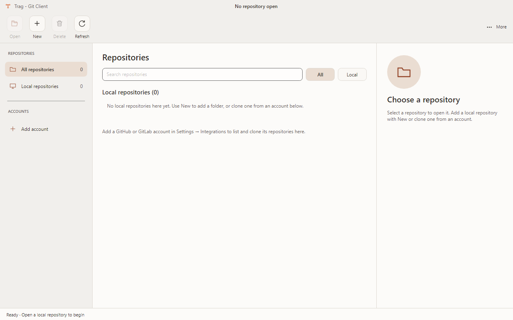
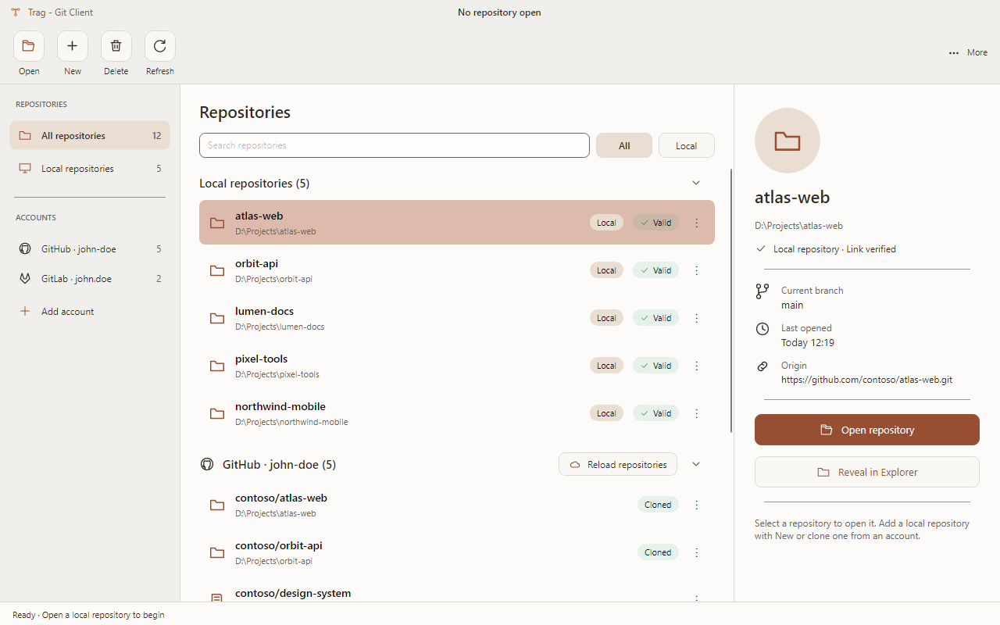
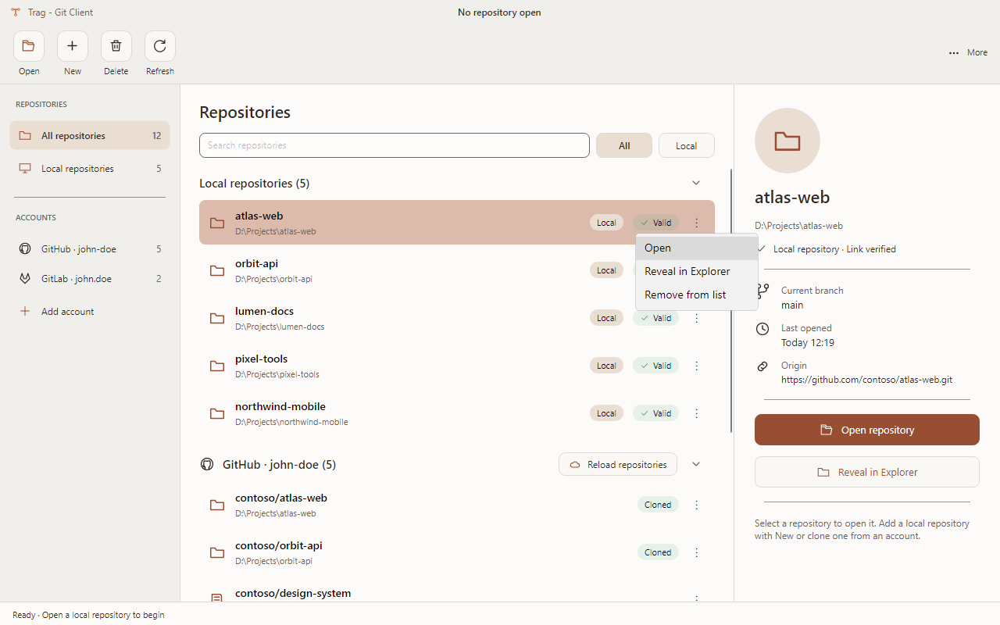
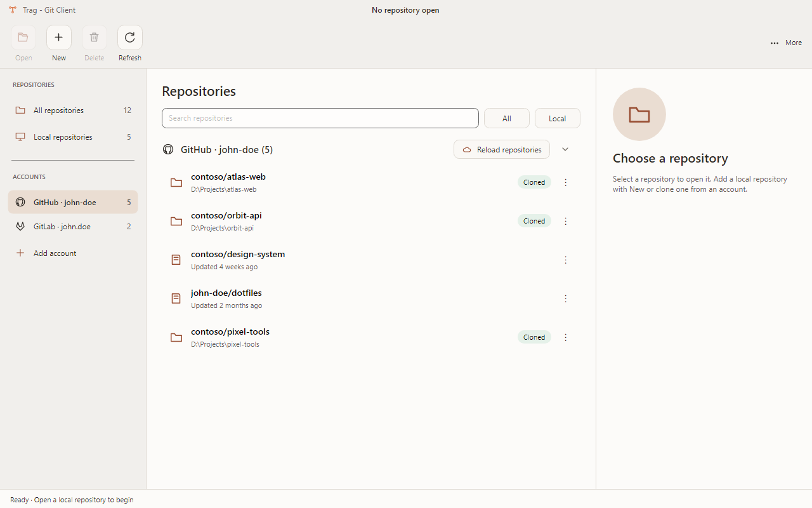
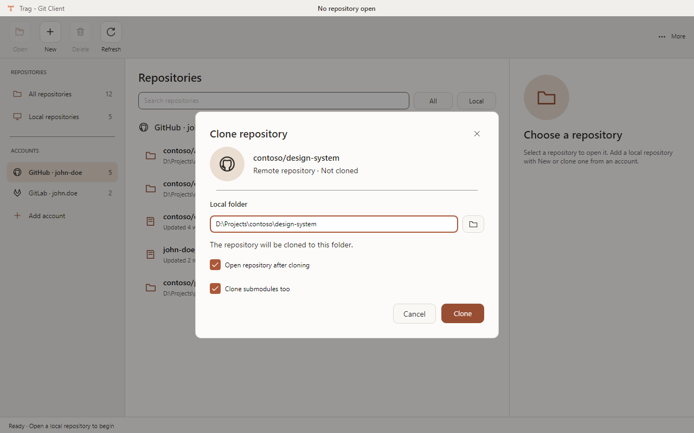
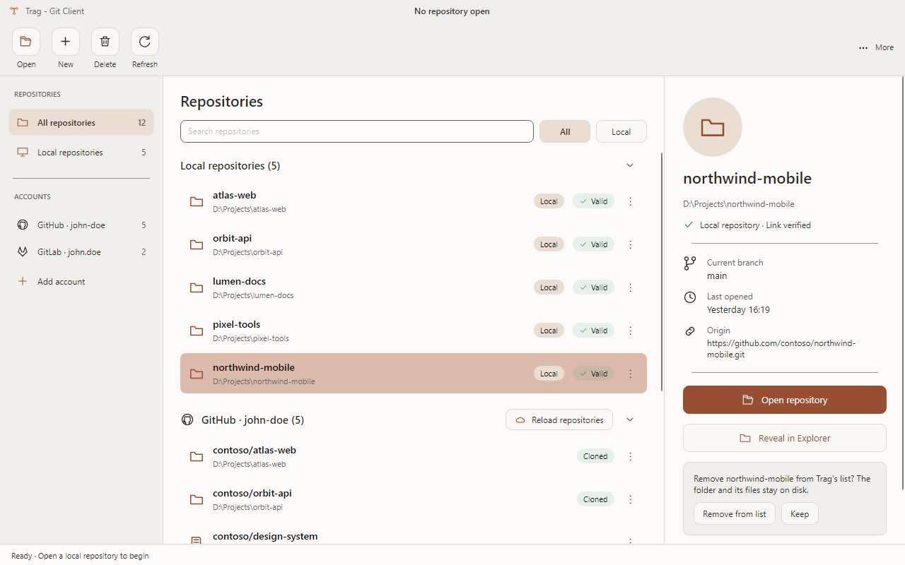
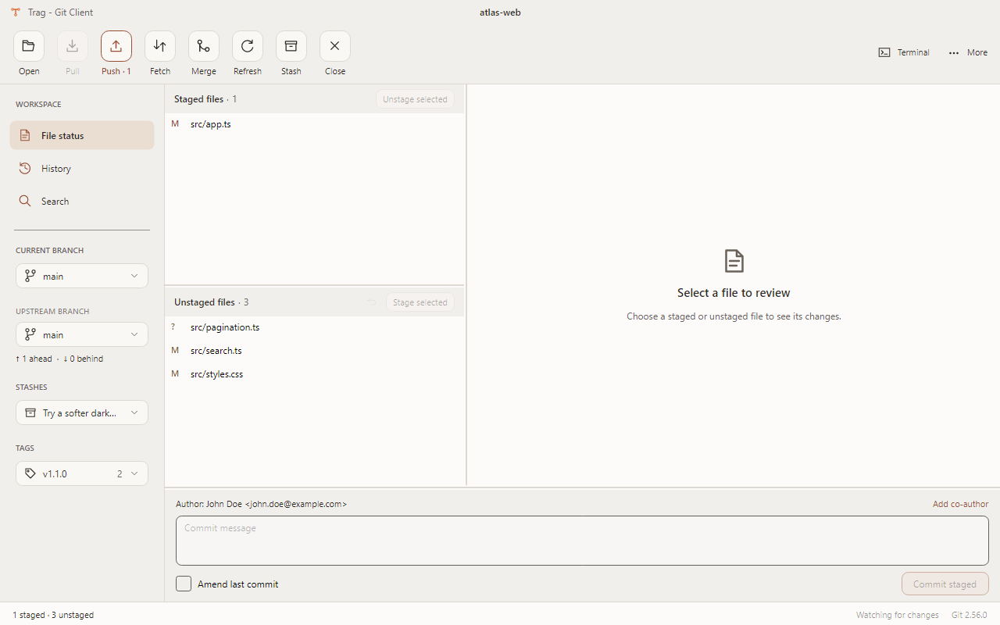

# 1. Repositories

The **Repositories** page is where Trag starts. It lists the Git repositories on your computer, together with the
repositories of the GitHub and GitLab accounts you have added, and lets you open, add, clone or remove them.

## The first start

On the very first start the list is empty. The left side has two groups: **Repositories**, which filters the list, and
**Accounts**, where your GitHub and GitLab accounts appear once you add them.

You can fill the list in two ways:

- Add a repository that is already on your computer with **New**.
- Add a GitHub or GitLab account and clone one of its repositories. See [Cloning a repository](#cloning-a-repository).

## Adding a local repository

Click **New** in the toolbar and choose the folder of a Git repository. Trag adds it to the list and remembers it the
next time you start.

If you choose an empty folder, Trag offers to initialize it as a new Git repository.

## The repository list

Each local repository shows its name, its folder and two labels. **Local** means the repository is on this computer.
**Valid** means Trag found a working Git repository in that folder. If the folder was moved or deleted, the label shows
**Missing** instead.

Click a repository to see its details on the right: the folder, the current branch, when you last opened it and the
address of its `origin` remote. From there you can open it, or show the folder in Explorer.

Some useful details:

- **Search repositories** filters the list by name or folder as you type.
- **All** and **Local** switch between every repository and only the ones on this computer. The same filters are in the
  sidebar, with a count next to each.
- The arrow next to a group header folds the group.
- **Refresh** checks every folder again and reloads the account lists.

The **⋮** button at the end of a row opens the actions for that repository: **Open**, **Reveal in Explorer** and
**Remove from list**.

## Account repositories

When you add a GitHub or GitLab account, its repositories appear in the list under the account's name. Click the
account in the sidebar to see only its repositories.

Repositories that are already on your computer are marked **Cloned** and show their local folder. The others show when
they were last updated. **Reload repositories** asks the provider for the current list.

To add an account, click **Add account** in the sidebar. This opens **Settings** on the **Integrations** page, which is
described in the chapter on accounts and settings.

## Cloning a repository

To get a copy of an account repository on your computer, open its **⋮** menu and choose **Clone**, or double-click it.
Double-clicking a repository that is already cloned opens it instead.

The dialog suggests a folder next to the repositories you already have, named after the owner and the repository. You
can type another path or pick one with the folder button.

- **Open repository after cloning** opens the new copy as soon as the clone finishes.
- **Clone submodules too** also downloads the submodules the repository uses.

Click **Clone** to start. The dialog shows the progress, and **Cancel** stops the clone while it runs. When it finishes,
the repository is added to your local list.

## Removing a repository from the list

Select a repository and click **Delete** in the toolbar, or choose **Remove from list** in its **⋮** menu. Trag asks you
to confirm on the right.

**Remove from list** only removes the entry from Trag. The folder and all its files stay on disk, and you can add the
repository again at any time with **New**. **Keep** leaves everything as it was.

## Opening a repository

Double-click a repository, select it and press **Enter**, or click **Open repository** in the details. Trag opens the
repository on the **File status** page, which shows your current changes.

While a repository is open, **Back** in the Repositories toolbar returns to it, so you can look at the list without
closing what you are working on.

The next chapter explains the main window and how to move around it.
