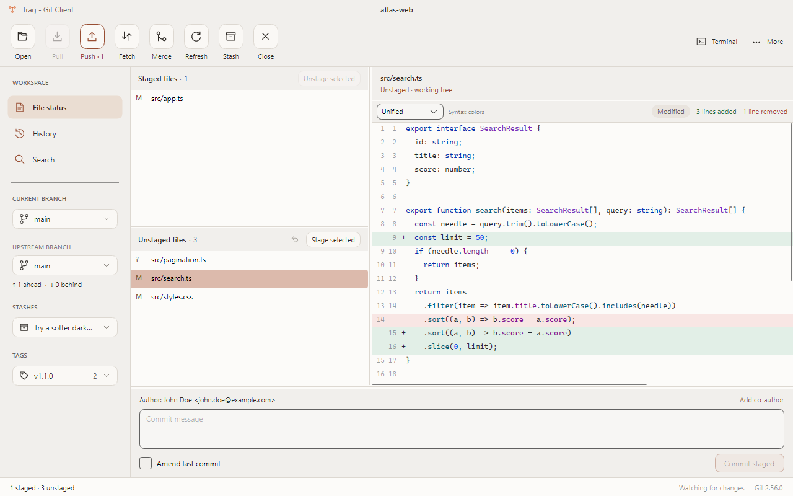
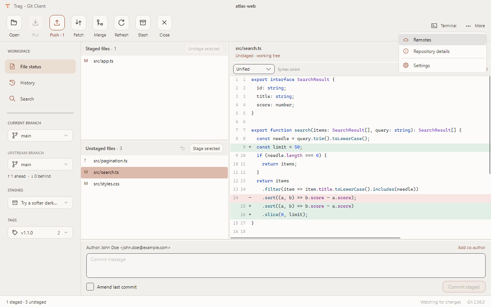
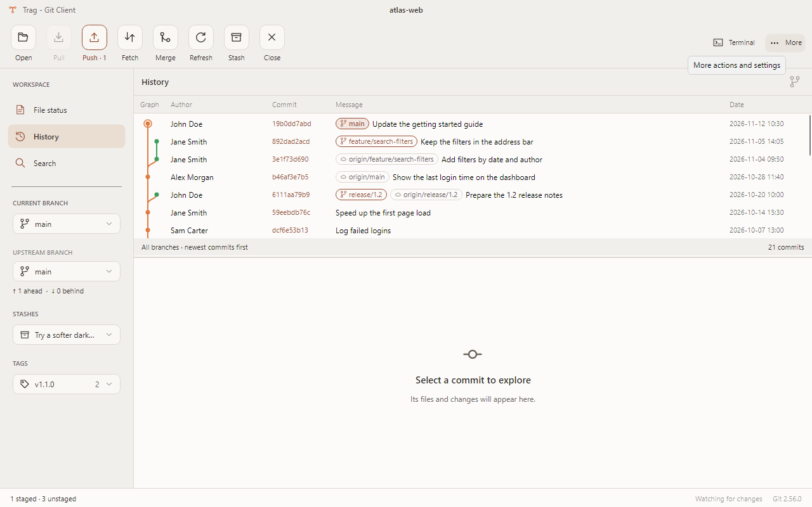
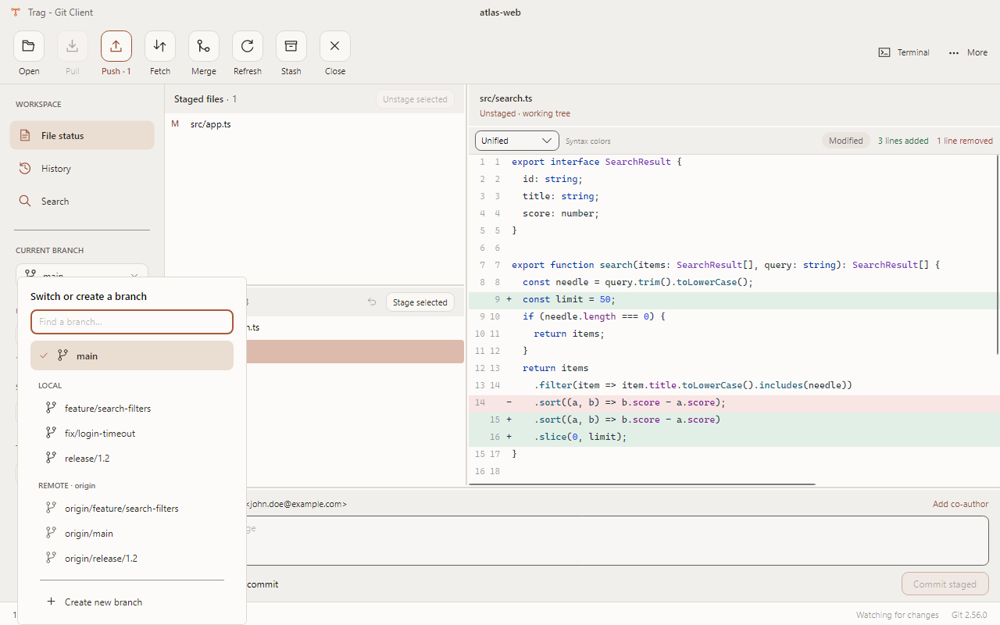
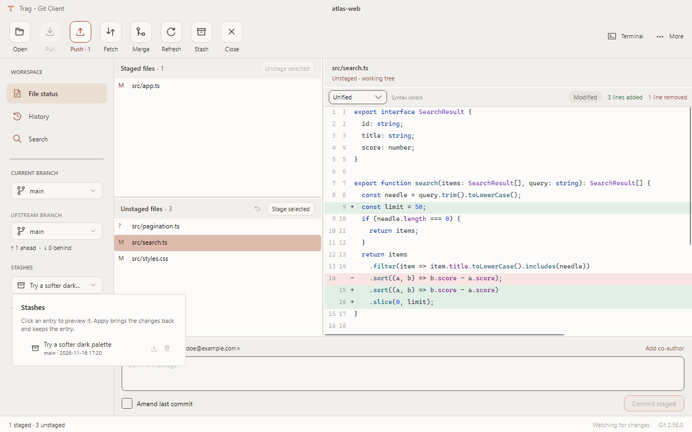
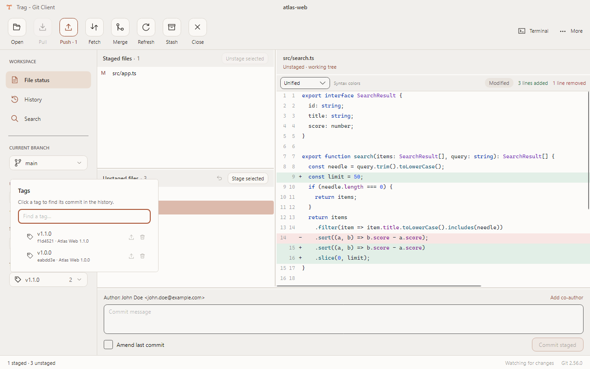

# 2. The main window

Once a repository is open, the main window shows everything about it in one place. This chapter walks through the
parts of the window and how to move between them, with the mouse or the keyboard.

The window has five parts:

- **The title bar** shows the name of the open repository.
- **The toolbar** holds the actions you use most: open, pull, push, fetch, merge, refresh, stash and close. On the
  right are **Terminal** and **More**.
- **The sidebar** on the left switches between the sections of the repository and shows the current branch, its
  upstream, the stashes and the tags.
- **The content area** in the middle shows the section you chose, here **File status** with the changed files and the
  diff of the selected file.
- **The status bar** at the bottom says what Trag is doing and sums up the changes, and shows the Git version in use.

## The toolbar

| Button | What it does |
|---|---|
| **Open** | Goes back to the [Repositories](01-repositories.md) page to open another repository |
| **Pull** | Brings the commits of the upstream branch into the current branch |
| **Push** | Sends your commits to the upstream branch. The number shows how many commits are waiting |
| **Fetch** | Downloads what is new on the remote without changing your branch |
| **Merge** | Merges one branch into another |
| **Refresh** | Reads the repository again |
| **Stash** | Puts your current changes aside in a stash |
| **Close** | Closes the repository |

Pull and Push are greyed out when they cannot run. Pull, for example, needs a working tree without changes, so commit
or stash your work first. When the current branch has no upstream yet, a **Publish** button takes the
place of Push.

**Terminal** opens a terminal in the repository folder, for the times you want the command line.

**More** holds the less frequent actions:

- **Remotes** lists the remotes of the repository and lets you add, change or remove them.
- **Repository details** shows a summary of the repository: its history, the people who contributed and where it
  lives.
- **Settings** opens the application settings. This entry is there even when no repository is open.

## The sections

The **Workspace** group at the top of the sidebar switches the content area between three sections:

- **File status** shows what changed in your working tree, lets you stage it and commit. See the chapter on committing
  changes.
- **History** shows the commits of the repository with a branch graph. See the chapter on history.
- **Search** searches the history by commit SHA, message or author.

While a merge, rebase or cherry-pick is in progress, or a stash could not be applied cleanly, the sidebar shows an
extra entry for it, with the number of conflicts or steps left.

## The current branch

The **Current branch** button shows the branch you are on. Click it to switch to another branch or create a new one.

Type in **Find a branch** to filter the list, then click a branch or press **Enter** to switch to it. Local branches and
the branches of each remote are listed separately. Choosing a remote branch switches to its local branch, or creates one that tracks it when there is none yet.
**Create new branch** at the bottom starts a new branch from the current commit.

## The upstream branch

**Upstream branch** is the remote branch that Pull and Push work with. Below it, Trag shows how many commits your branch
is ahead (yours, not pushed yet) and behind (the remote's, not pulled yet). Click the button to choose a different
upstream branch. If the repository has more than one remote, a second button lets you choose the remote as well.

## Stashes and tags

The **Stashes** button lists your stashes. Click an entry to preview its changes, use the arrow to apply it, or the bin
to drop it. Applying keeps the stash, so you can apply it again.

The **Tags** button lists the tags of the repository. Type in **Find a tag** to filter them, and click a tag to find its commit in the history. The
arrow pushes the tag to the remote and the bin deletes it.

## Keyboard shortcuts

Every main action has a shortcut. Hovering over a button also shows its shortcut.

| Shortcut | Action |
|---|---|
| `Ctrl+O` | Open another repository |
| `Ctrl+W` | Close the repository |
| `F5` | Refresh the repository, or the repository list when it is shown |
| `Ctrl+1` | Go to File status and focus the file list |
| `Ctrl+2` | Go to History and focus the commit list |
| `Ctrl+F` or `Ctrl+3` | Go to Search and focus the search box |
| `Ctrl+K` | Focus the commit message |
| `Ctrl+Enter` | Commit the staged changes, on the File status section |
| `Ctrl+Shift+F` | Fetch |
| `Ctrl+Shift+L` | Pull |
| `Ctrl+Shift+P` | Push |
| `Ctrl+Shift+M` | Merge |
| `Ctrl+Shift+K` | Stash changes |
| `Ctrl+,` | Open Settings |
| `Esc` | Cancel the running operation, or close the open dialog |

In lists, the arrow keys move the selection and **Enter** opens or confirms the selected item. In the file lists and the
diff, the menu key or `Shift+F10` opens the same menu a right-click does.
