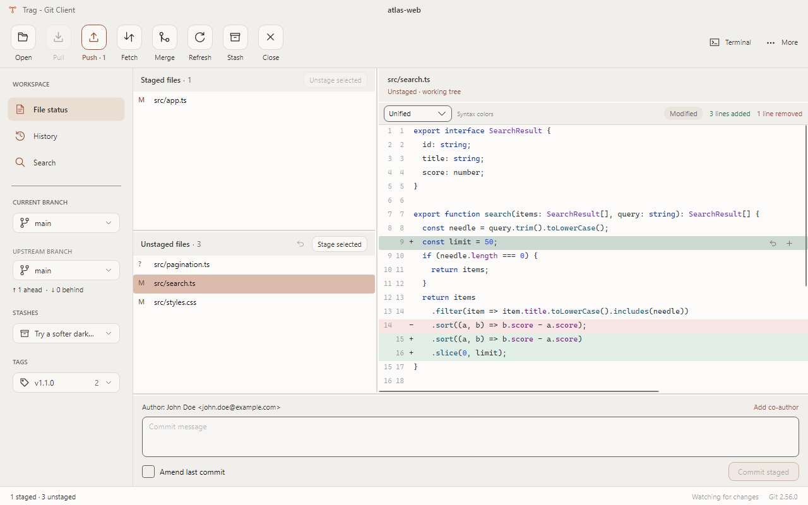
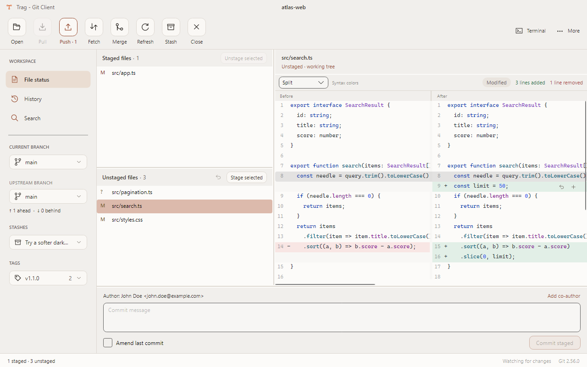
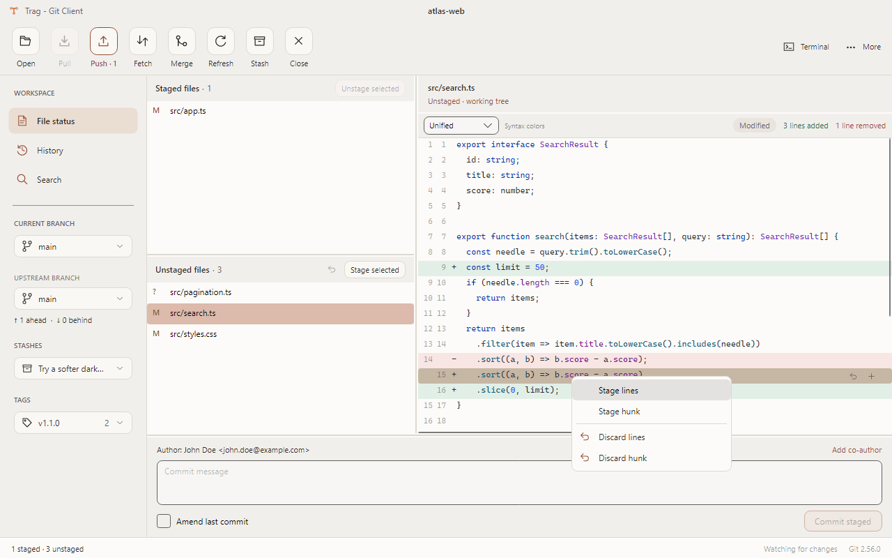
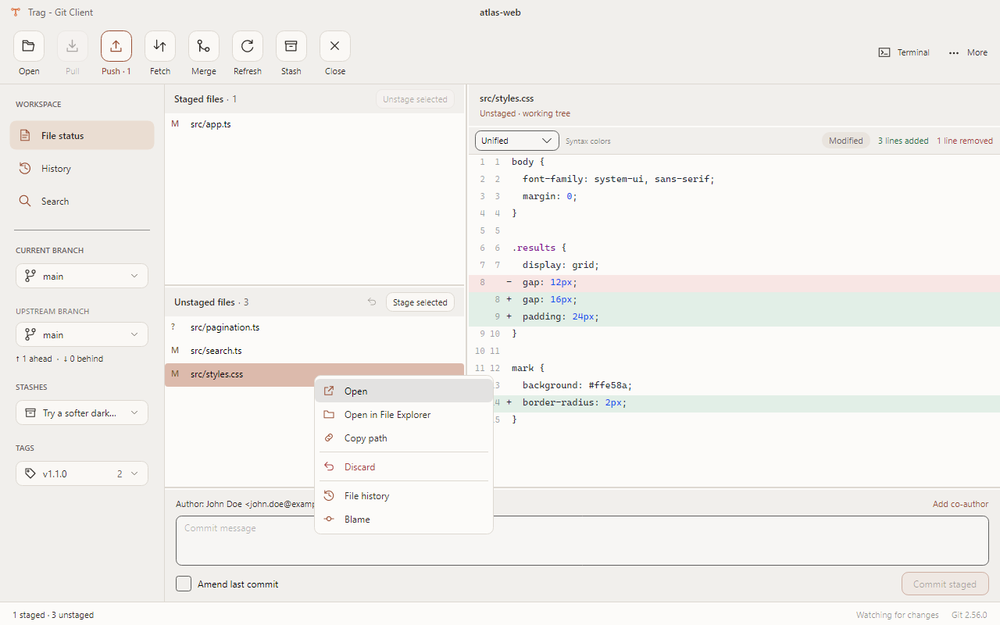
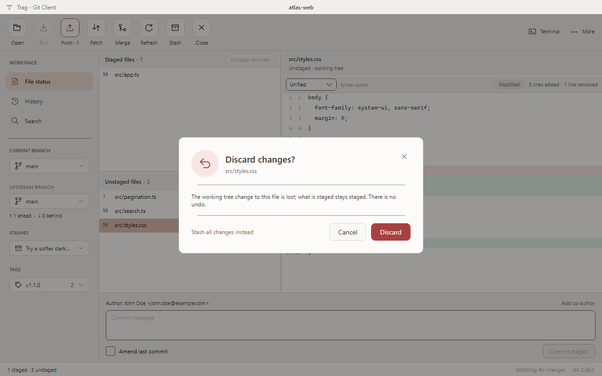
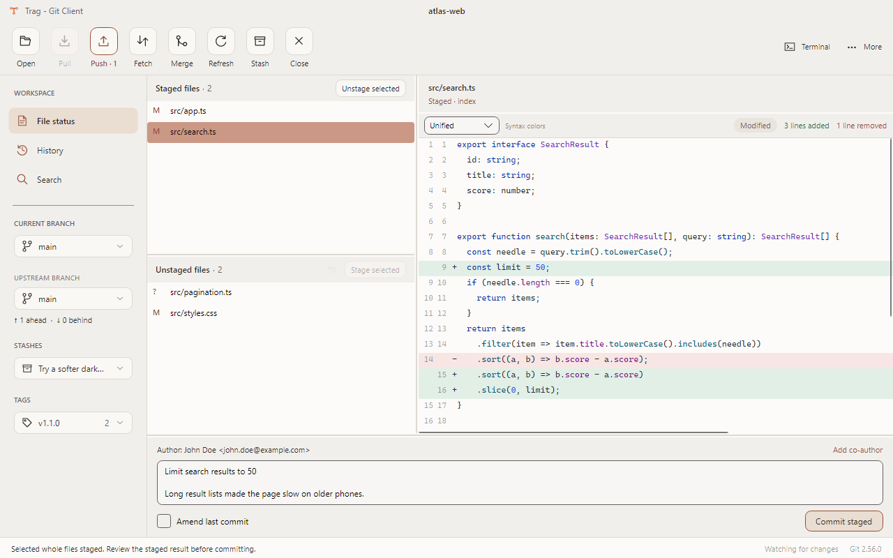
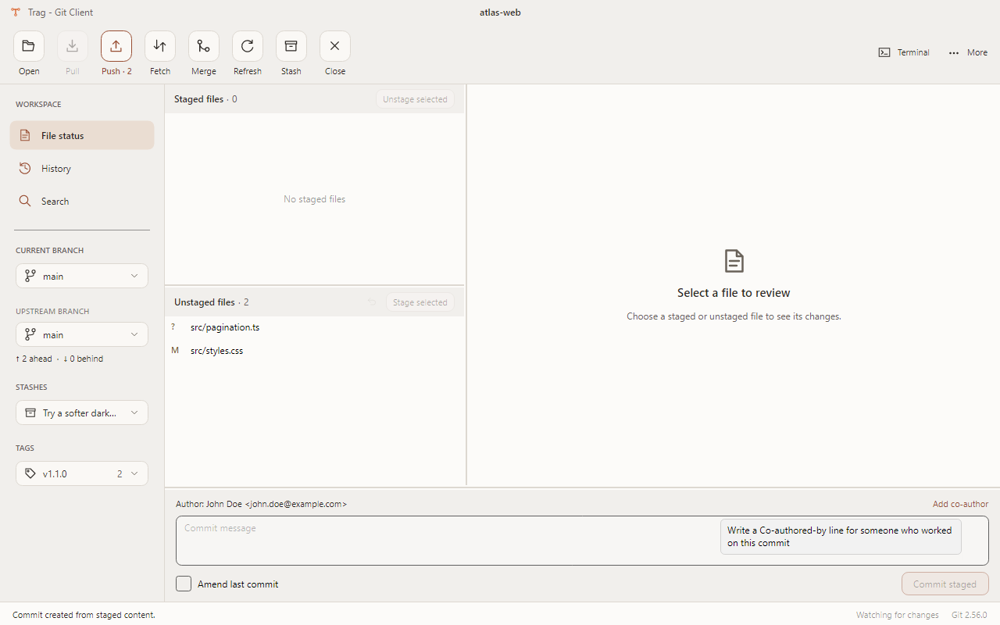
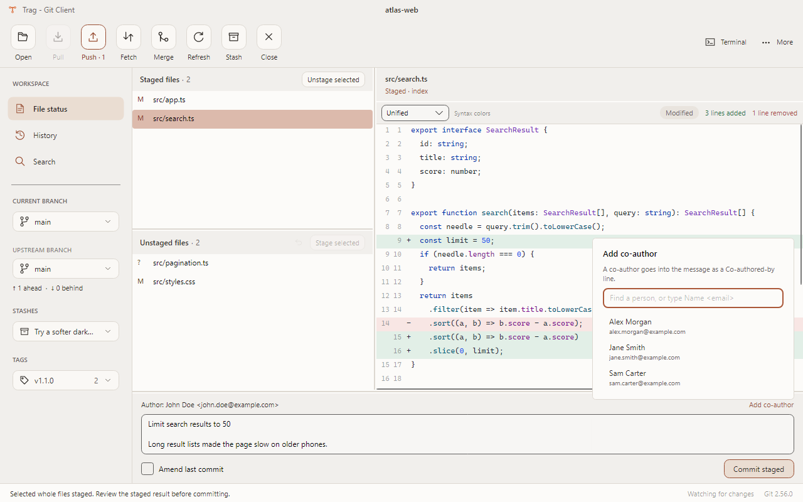
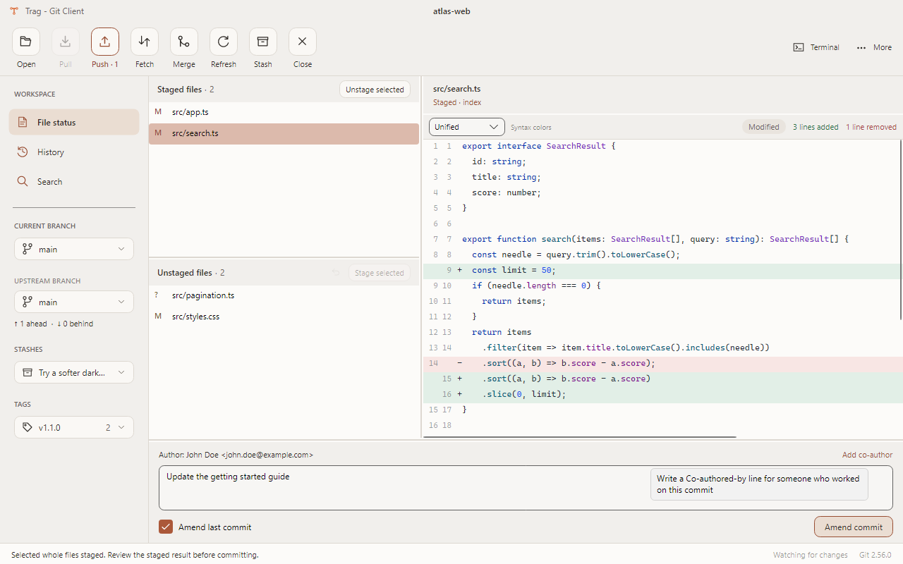

# 3. Committing changes

The **File status** section is where you review what changed, choose what goes into the next commit and write the
commit. Open it from the sidebar or with `Ctrl+1`.

## Staged and unstaged files

Trag splits your changes into two lists:

- **Unstaged files** are changes in your working tree that are not part of the next commit yet.
- **Staged files** are the changes that the next commit will contain.

The letter in front of each file says what happened to it: **M** modified, **A** added, **D** deleted, **R** renamed,
and **?** a new file Git does not track yet. The number next to each heading counts the files in the list.

## Reviewing a change

Click a file to see its diff on the right. Removed lines are red, added lines are green, and the two columns of line
numbers show where each line was before and after the change. The header shows whether the file was modified, added or
deleted, and how many lines were added and removed.

When the pointer is over a change, two small buttons appear at the right end of that block of changes, called a
hunk: the arrow discards the hunk and **+** stages it.

The selector above the diff switches between two layouts:

- **Unified** shows the old and the new lines in one column.
- **Split** shows the file before the change on the left and after it on the right.

**Syntax colors** turns code highlighting on and off.

## Staging

You can stage as much or as little as you like:

- **A whole file.** Select one or more files in **Unstaged files** and click **Stage selected**. With several files
  selected, the button says how many it stages.
- **A hunk.** Point at a block of changes in the diff and click **+**.
- **Single lines.** Click a line in the diff, hold `Ctrl` or `Shift` to choose more, then right-click and choose
  **Stage lines**. **Stage hunk** stages the whole block under the pointer.

The same menu offers **Discard lines** and **Discard hunk** to throw changes away. When a hunk has only one changed
line, the menu offers the hunk alone, since the two would be the same.

To take something out of the next commit, do the same in **Staged files**: select files and click **Unstage
selected**, or choose lines and hunks in the diff of a staged file.

## The file menu

Right-click a file, or select it and press the menu key, for more actions:

- **Open** opens the file in the program Windows uses for it.
- **Open in File Explorer** shows the file in its folder.
- **Copy path** copies the file's path.
- **Ignore** adds a rule to `.gitignore` for the file itself, for every file with its extension, or for its folder. It
  appears only for files Git does not track yet.
- **Discard** throws away the changes in the file.
- **File history** shows the commits that changed the file.
- **Blame** shows who last changed each line of the file.

For a submodule, **Open submodule** opens it as its own repository.

## Discarding changes

To throw away the changes in some files, select them in **Unstaged files** and click the arrow next to **Stage
selected**, or choose **Discard** in the file menu. Trag asks first, because discarded changes cannot be brought back.

What is staged stays staged; only the working tree change is lost. If you are not sure, **Stash all changes instead**
puts everything aside in a stash, where you can get it back later.

## Writing the commit

Type the commit message in the box at the bottom. The first line is the summary that history lists show; leave an
empty line after it and add a longer description if the change needs one. Trag shows the author the commit will
have above the box.

Click **Commit staged** or press `Ctrl+Enter`. `Ctrl+K` moves the focus to the message box from anywhere in the
window.

When the commit is made, the staged list empties, the status bar confirms it and **Push** counts one more commit to
send.

If your Git configuration signs commits, a line above the message says so, for example "Commits are signed with your
SSH key".

## Co-authors

When someone else worked on the change with you, click **Add co-author**. Pick a person who already has commits in
the repository, or type a name and address as `Name <email>`.

Trag adds a `Co-authored-by` line for each co-author to the message, and lists them above the message box, where you
can remove one again.

## Amending the last commit

Tick **Amend last commit** to change the last commit instead of making a new one. The message box fills with that
commit's message, so you can correct it, and anything you have staged is added to the commit. The button changes to
**Amend commit**.

If the last commit is already on the remote, Trag warns you: after amending, Push has to replace the commit there. Only
do that when nobody else has built on it.
