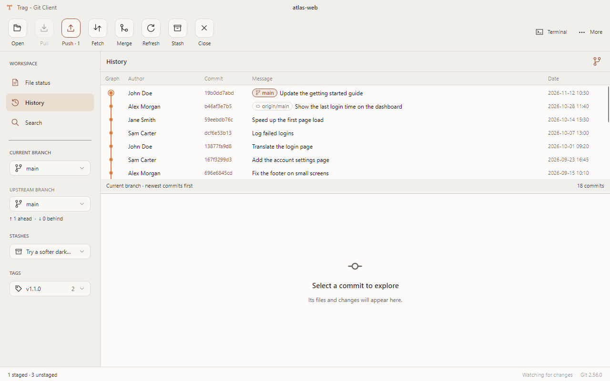
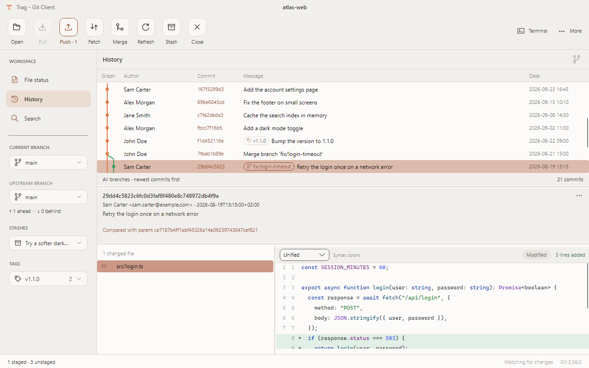
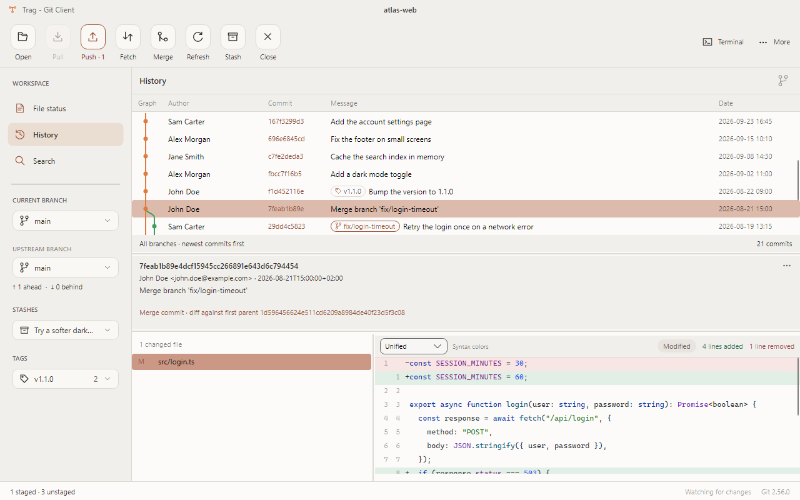
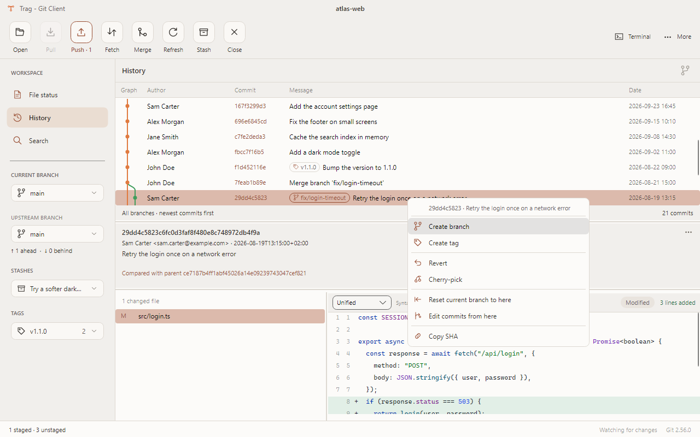
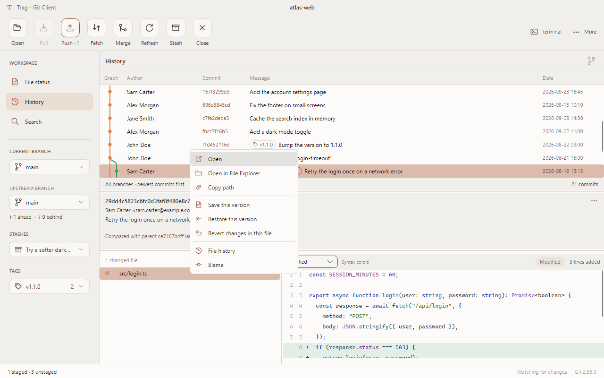
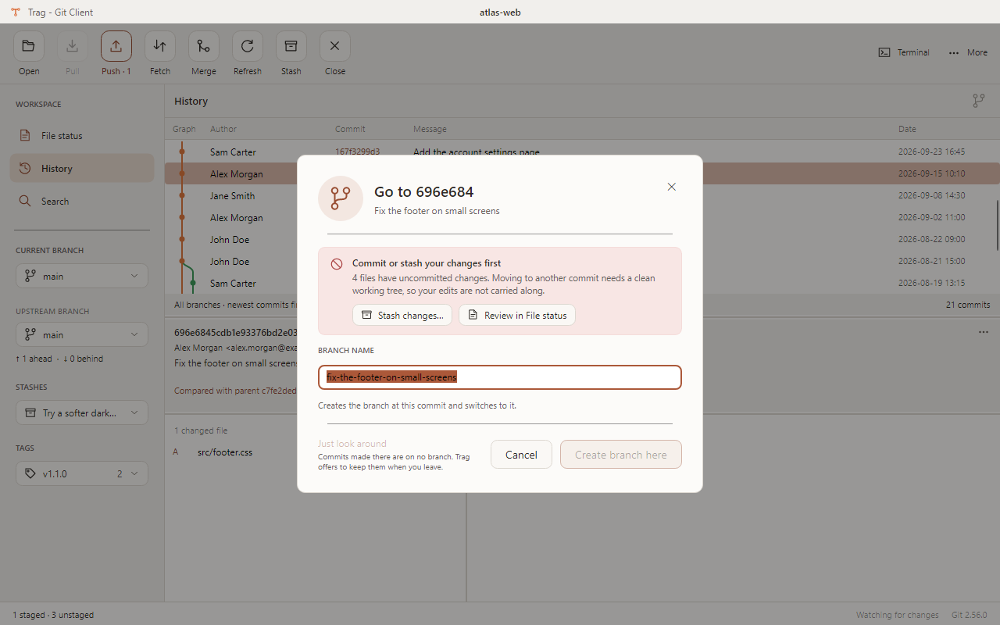
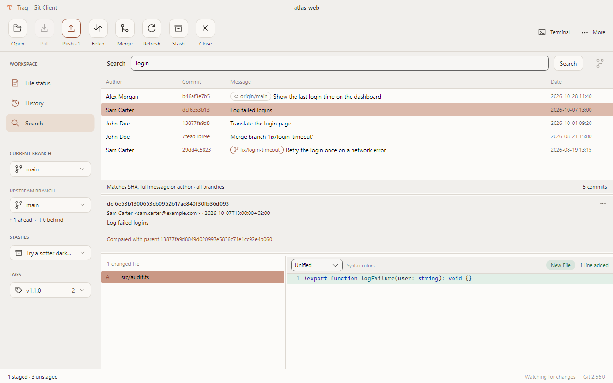
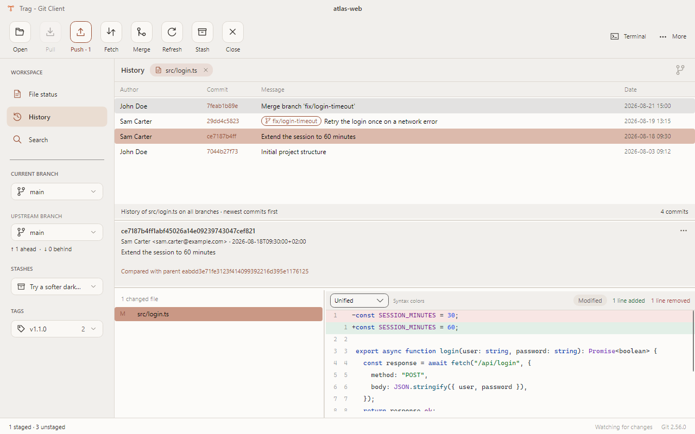
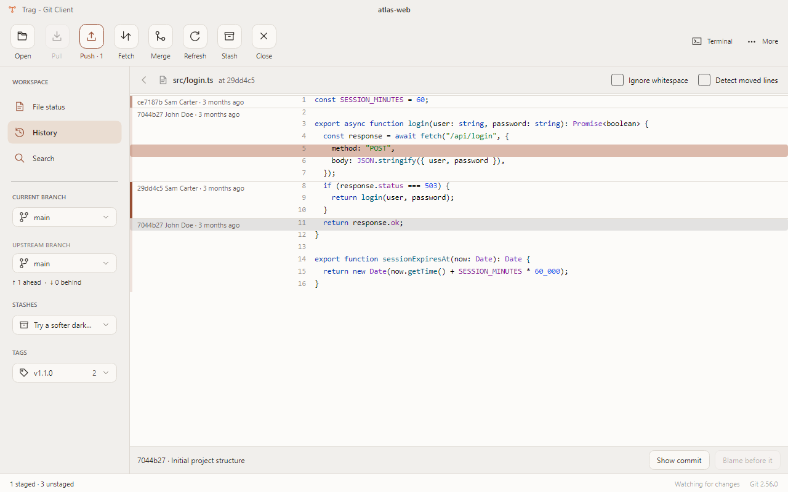

# 4. History

The **History** section shows the commits of the repository, newest first, with a graph of how the branches split and
join. Open it from the sidebar or with `Ctrl+2`.

## The commit list

Each row shows the graph, the author, the short commit id, the message and the date. Labels in front of the message
mark where branches and tags point: a branch has a branch icon, a remote branch a cloud icon, and a tag a tag icon. The
current branch is highlighted.

The list has no page limit. Scroll down and Trag reads the next commits as you get near the end, all the way to the
first commit of the repository. The footer counts the commits shown.

By default the list shows the commits of all branches. The branch button at the top right switches to the current
branch only, and back.

## A commit's details

Click a commit to see its details below the list: the full commit id, the author with address and date, the whole
message, and the parent it is compared with. Co-authors and the signature, when the commit has them, are shown there
too.

Under the details are the files the commit changed. Click a file to see what the commit did to it. The dividers between
the list, the details and the diff can be dragged, and Trag remembers where you left them.

A merge commit is compared with its first parent, so its diff shows what the merge brought into the branch.

## Working with a commit

Right-click a commit, or use the **⋯** button in its details, for the actions that start from it:

- **Create branch** and **Create tag** start a branch or a tag at this commit.
- **Revert** makes a new commit that undoes this one.
- **Cherry-pick** copies this commit onto the current branch.
- **Reset current branch to here** moves the current branch to this commit.
- **Edit commits from here** rewrites the commits after this one: reword, reorder, squash or drop them.
- **Copy SHA** copies the full commit id.

These actions are described in detail in the chapters on branches and on merging and rebasing.

## A file at a commit

Right-click a file in a commit's file list for actions on that version of the file:

- **Open**, **Open in File Explorer** and **Copy path** work as in File status.
- **Save this version** saves the file as it was in this commit to a place you choose, without touching the
  repository.
- **Restore this version** gives the file in your working tree the content it has in this commit. Trag asks first,
  because the file's current changes are lost. The index is not changed.
- **Revert changes in this file** undoes only what this commit did to this file, in your working tree.
- **File history** and **Blame** are described below.

## Going to an older commit

Double-click a commit to go to it. Trag suggests creating a branch there, named after the commit message, and switching
to it. **Just look around** goes to the commit without a branch instead. Commits you make there belong to no branch, so
Trag offers to keep them on a branch when you leave.

Moving to another commit needs a working tree without changes. If you have some, the dialog says so and offers to
stash them or to review them in File status first.

## Searching the history

The **Search** section, or `Ctrl+F`, searches all branches by commit id, by the full commit message or by author. Type
and the results update as you go. Click a result to see its details, as in History.

## The history of a file

Choose **File history** in the menu of a file, in File status or in a commit. The list then shows only the commits that
changed that file. The file's name appears next to the **History** heading; click its **×** to see the whole history
again.

## Blame

**Blame** shows, for every line of a file, the commit that last changed it. Lines that came from the same commit are
grouped, and the colored stripe on the left is stronger the newer the change is.

Click a line to see its commit at the bottom. **Show commit** opens that commit in the history. **Blame before it**
shows the file as it was before that commit, so you can follow a line further back.

Two options refine the result:

- **Ignore whitespace** keeps the original commit for lines that only changed their indentation or spacing.
- **Detect moved lines** keeps the original commit for lines that were moved within the file, or copied from another
  file in the same commit.

The arrow at the top left goes back to where you came from.
