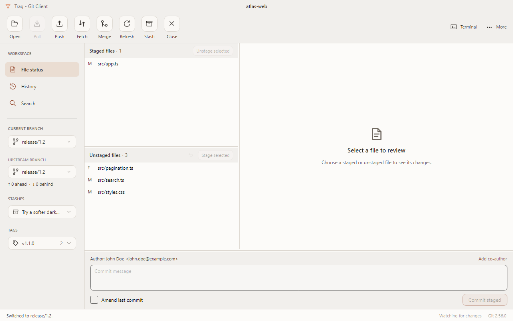
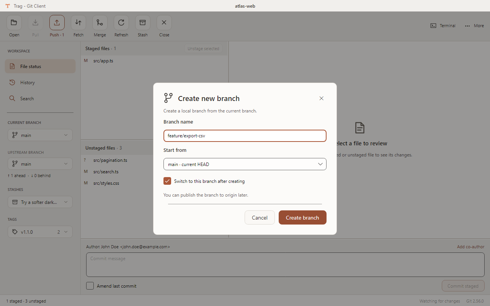
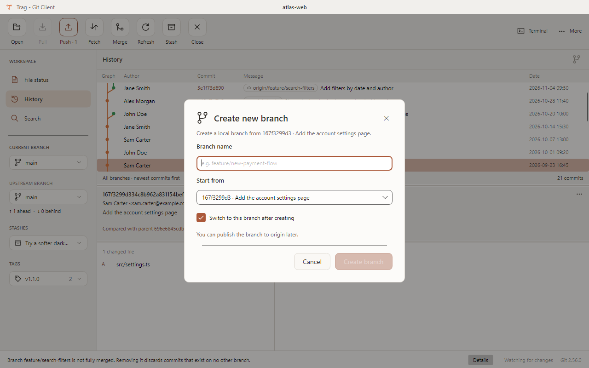
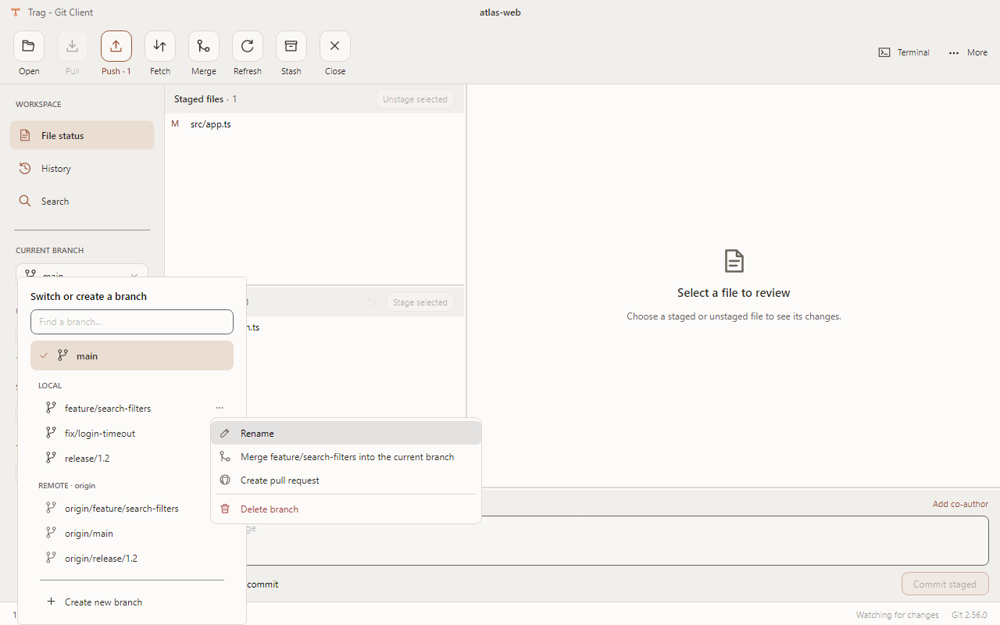
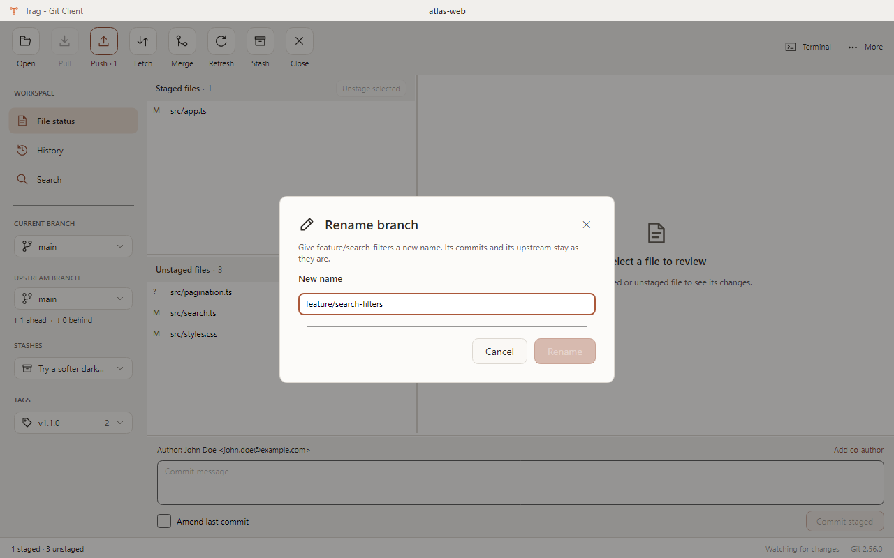
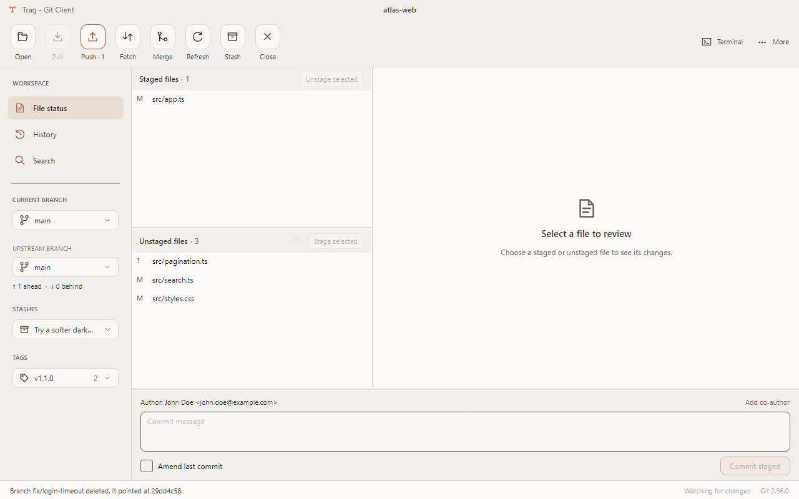
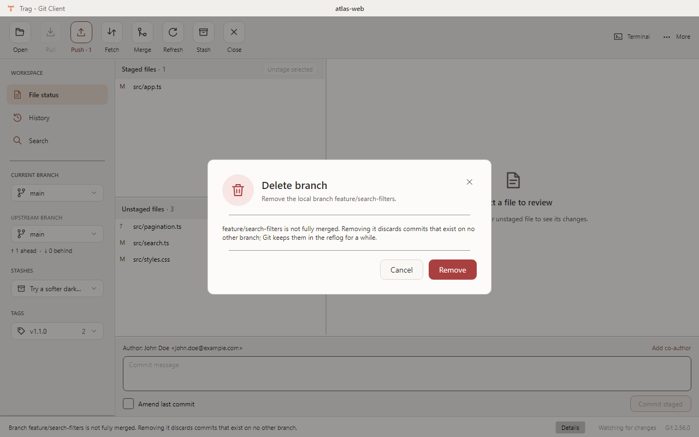
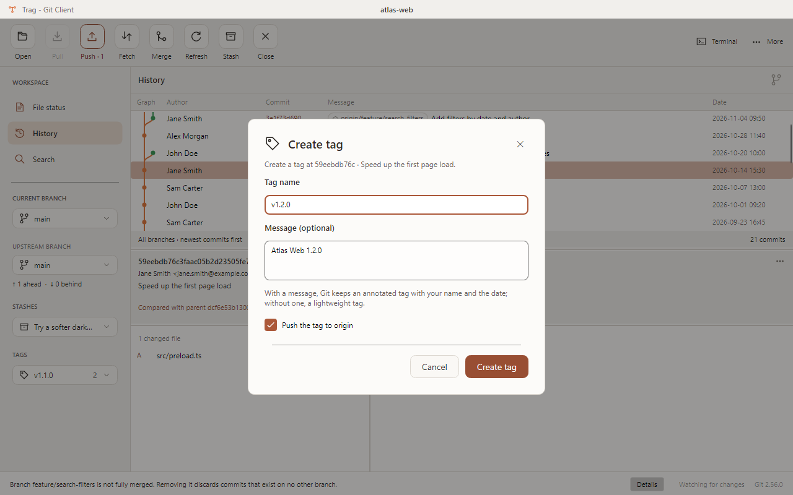
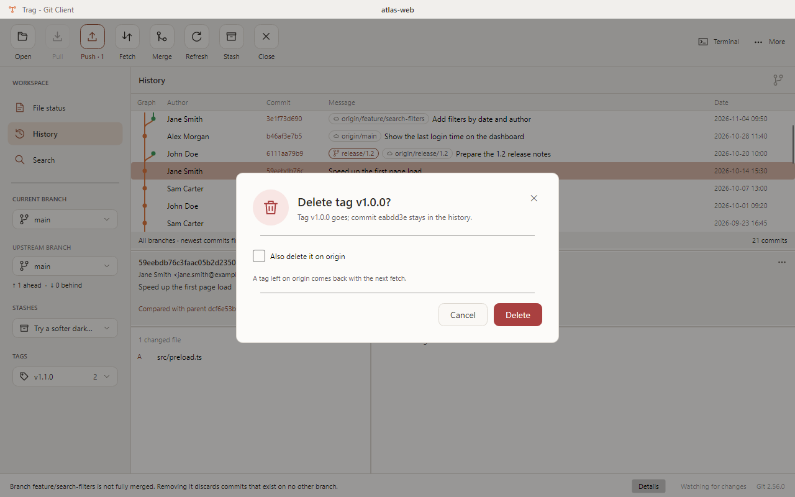

# 5. Branches and tags

Branches let you work on several things at once without mixing them up. Tags mark a commit that matters, usually a
release. This chapter shows how to create, switch, rename and delete branches, and how to create and delete tags.

## Switching branches

Click **Current branch** in the sidebar, then click the branch you want. Type in **Find a branch** to narrow the list,
and press **Enter** to switch to the first match.

Your uncommitted changes come with you to the other branch, as long as they do not touch files the two branches have
different versions of. Here the three changed files moved to `release/1.2` with the switch.

When the switch would overwrite your changes, Git keeps the current branch and Trag lists the files in the way. Commit
or stash those changes, then switch again.

Choosing a remote branch, such as `origin/feature/search-filters`, switches to its local branch, or creates a local
branch that tracks it when there is none yet.

## Creating a branch

Click **Create new branch** at the bottom of the branch list.

- **Branch name** is checked as you type. Trag tells you if the name is not allowed or already taken.
- **Start from** is where the branch begins. It starts at the current commit, and the list offers your other local and
  remote branches as well.
- **Switch to this branch after creating** switches to the new branch right away. Untick it to create the branch and
  stay where you are.

The new branch exists only on your computer until you publish it. See the chapter on syncing with remotes.

To start a branch at an older commit, right-click the commit in **History** and choose **Create branch**. The dialog
then starts from that commit.

## Branch actions

Point at a branch in the list and click **⋯** for its actions:

- **Rename** gives the branch a new name.
- **Merge into the current branch** merges it into the branch you are on. See the chapter on merging and rebasing.
- **Create pull request** opens the page on GitHub, or **Create merge request** on GitLab, where you can propose the
  branch for review. It is available when the repository's remote is on one of those providers.
- **Delete branch** removes the branch.

### Renaming

Type the new name and click **Rename**. The name is checked the same way as for a new branch.

### Deleting

When every commit of the branch is also on another branch, for example because it was merged, Trag deletes it right
away. The status bar says which commit it pointed at, in case you want it back.

When the branch has commits that are on no other branch, Trag asks first, because deleting it discards them. Git keeps
them in the reflog for a while, but they no longer show in the history.

Deleting a remote branch always asks first, because it removes the branch on the remote for everyone.

## Tags

### Creating a tag

Right-click a commit in **History** and choose **Create tag**.

- **Tag name** is the name of the tag, such as `v1.2.0`.
- **Message** is optional. With a message, Git creates an annotated tag that records your name and the date; without
  one, a lightweight tag that only points at the commit. If your Git configuration signs tags, the message is required.
- **Push the tag to origin** sends the tag to the remote right after it is created. Only the tag is pushed; your
  branches stay as they are.

### Finding, pushing and deleting tags

The **Tags** button in the sidebar lists every tag. Click a tag to find its commit in the history. The arrow pushes a tag
to the remote and the bin deletes it.

Deleting a tag removes it from your repository; the commit stays in the history. Tick **Also delete it on origin** to
remove it from the remote too. A tag that stays on the remote comes back with the next fetch.
