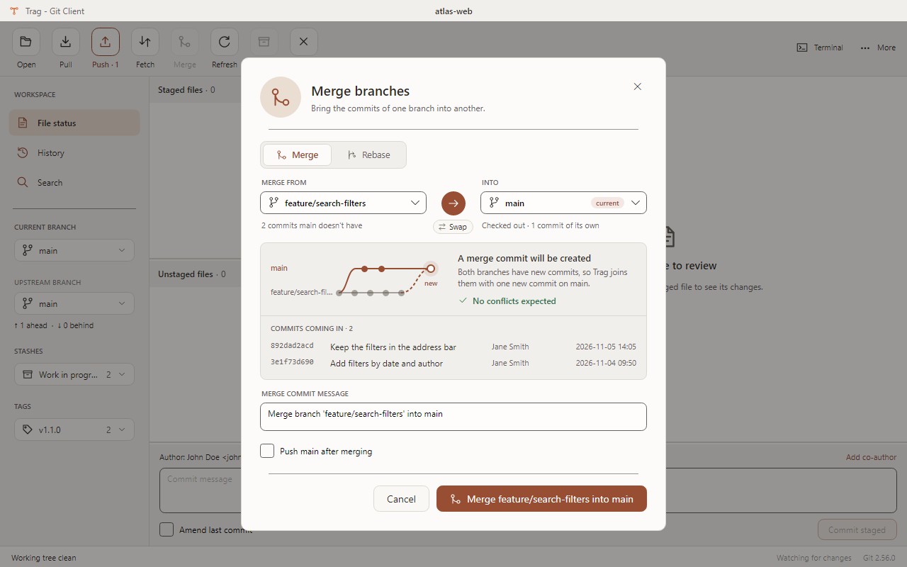
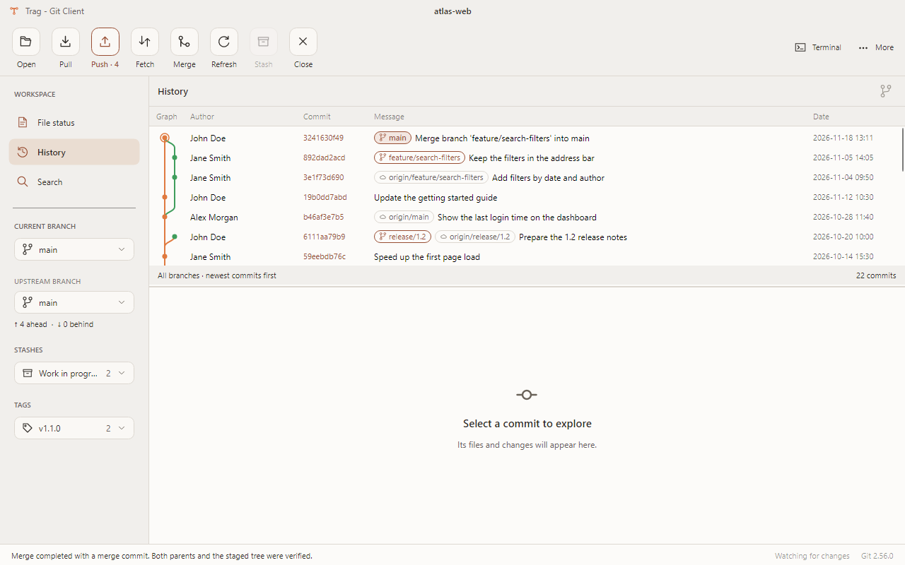
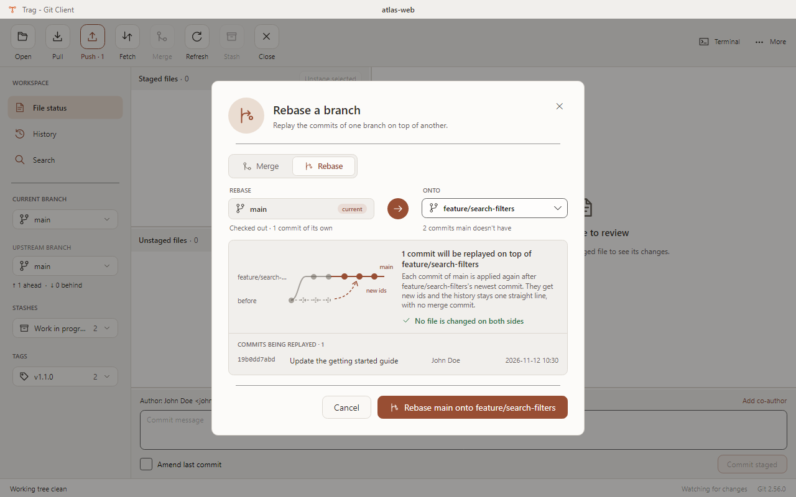
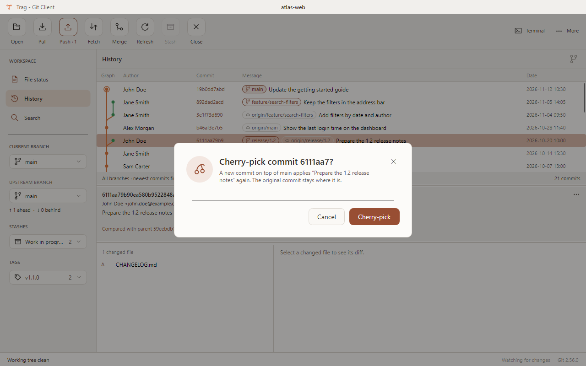
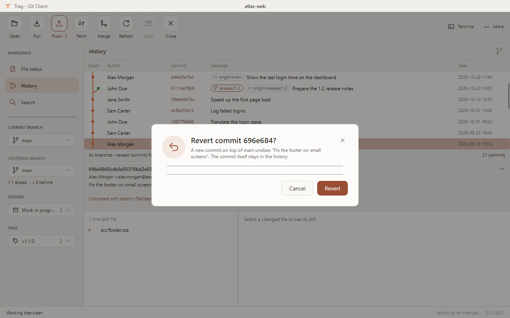
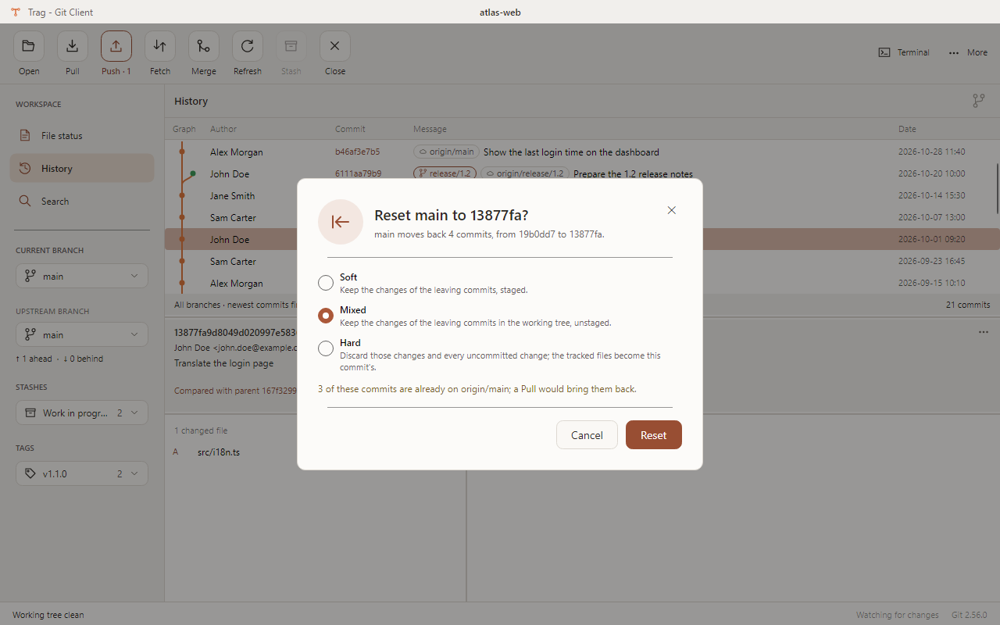
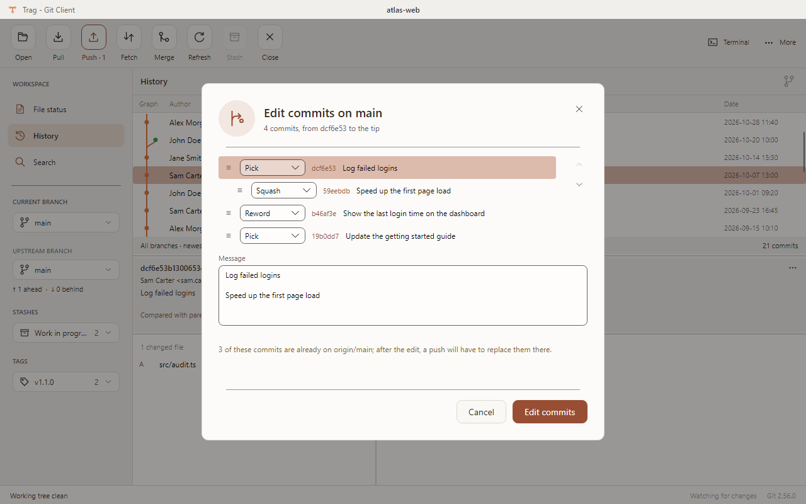

# 6. Merging and rebasing

Sooner or later the work on one branch has to reach another. This chapter covers merging and rebasing branches, and
the commit actions that move or undo changes: cherry-pick, revert, reset and editing commits.

Every one of these actions shows what it is about to do and waits for you to confirm. When it needs a working tree
without changes, the dialog says so and offers to stash them or to review them in File status first.

## Merging branches

Click **Merge** in the toolbar or press `Ctrl+Shift+M`. You can also start from a branch: open its **⋯** menu in the
branch list and choose **Merge into the current branch**.

- **Merge from** is the branch whose commits you bring in, and **Into** the branch that receives them. **Swap** turns
  the direction around.
- The picture in the middle shows what will happen. When both branches have new commits, Trag joins them with a new
  merge commit. When the target has nothing of its own, the merge just moves it forward, which Git calls a
  fast-forward. Tick **Create a merge commit anyway** to get a merge commit in that case too.
- Trag checks in advance whether the merge will run into conflicts, and says **No conflicts expected** when it will
  not.
- **Commits coming in** lists the commits the merge brings.
- **Merge commit message** is prefilled and can be edited.
- **Push main after merging**, named after the target branch, pushes it as soon as the merge is done.

Click the merge button at the bottom to merge. The history then shows the two lines joining in the merge commit.

If the branches do conflict, the merge stops and Trag helps you resolve the conflicts. See the chapter on resolving
conflicts.

## Rebasing a branch

**Rebase** at the top of the same dialog switches to rebasing. A rebase replays the commits of the current branch on
top of another branch, as if you had started your work from there.

The commits get new ids and the history stays one straight line, without a merge commit. **Commits being replayed**
lists the commits that move. Rebase only branches that nobody else has built on yet, because the old commits are
replaced.

## Cherry-pick

To copy a single commit onto the current branch, right-click it in **History** and choose **Cherry-pick**.

Trag makes a new commit on the current branch that applies the same change again. The original commit stays where it
is.

## Revert

To undo a commit without rewriting history, right-click it and choose **Revert**.

Trag makes a new commit that does the opposite of the chosen one. The original commit stays in the history, so this is
safe even for commits that are already pushed.

## Reset

**Reset current branch to here** moves the current branch back to the chosen commit. The dialog says how many commits
leave the branch and asks what should happen to their changes:

- **Soft** keeps the changes of the leaving commits, staged, ready to commit again.
- **Mixed** keeps them in the working tree, unstaged. This is the default.
- **Hard** throws those changes away, together with every uncommitted change. The tracked files become exactly the
  chosen commit's.

When some of the leaving commits are already on the remote, the dialog warns you that a Pull would bring them back.

## Editing commits

**Edit commits from here** opens a list of the chosen commit and every commit after it on the current branch. For each
commit you choose what happens to it:

- **Pick** keeps the commit as it is.
- **Reword** keeps the change but lets you write a new message.
- **Squash** folds the commit into the one above it and combines their messages.
- **Fixup** folds the commit into the one above it and keeps only that commit's message.
- **Drop** removes the commit.

Drag a commit by its handle, or use `Alt+Up` and `Alt+Down`, to change the order. The **Message** box shows the message
of the selected commit when you reword or squash it.

When some of the commits are already on the remote, the dialog warns that a push will have to replace them there.
Editing across a merge commit is not supported yet; the dialog says so when the range contains one.

Click **Edit commits** to apply your choices. If a commit cannot be applied cleanly, the edit stops on it so you can
resolve the conflict, and the sidebar shows the rebase in progress.
