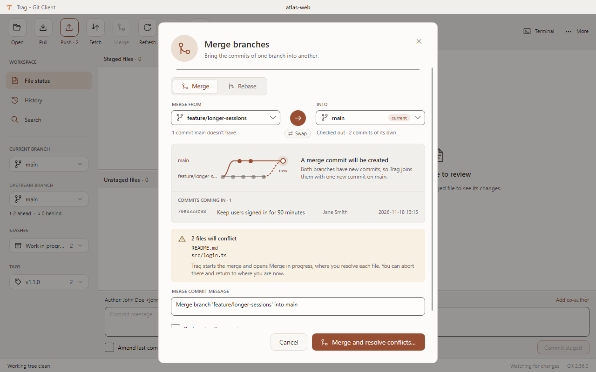
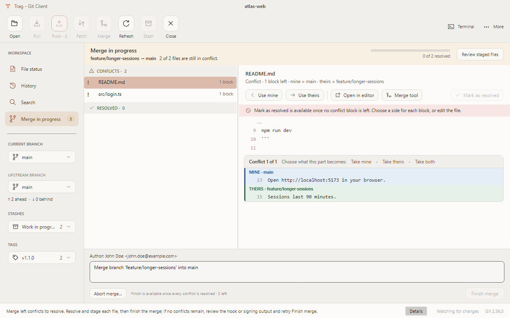
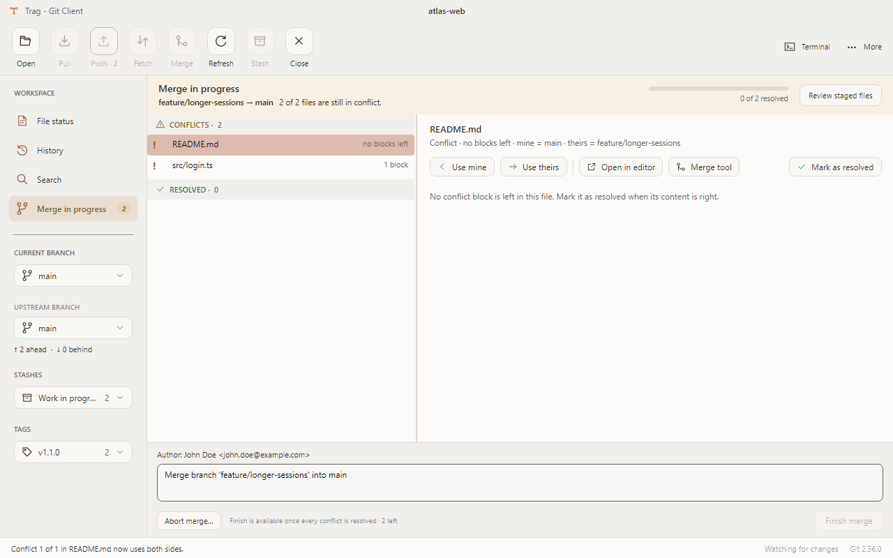
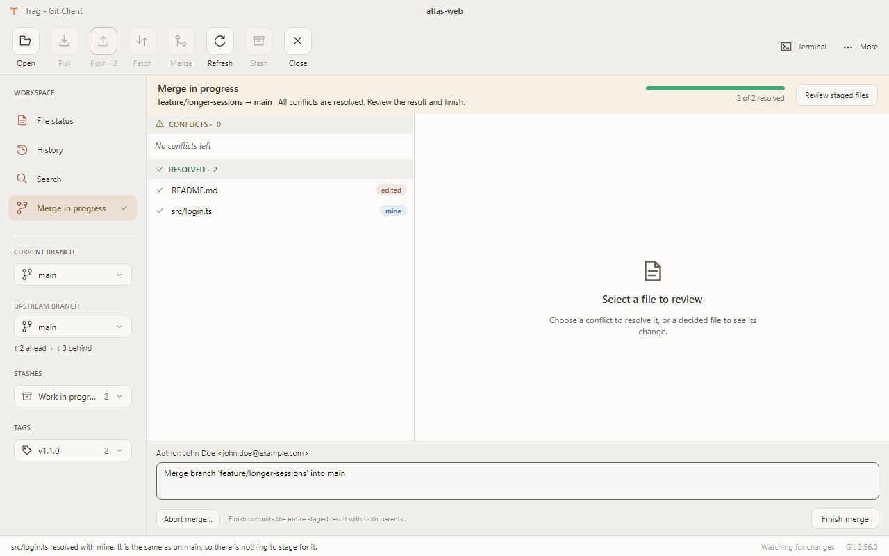
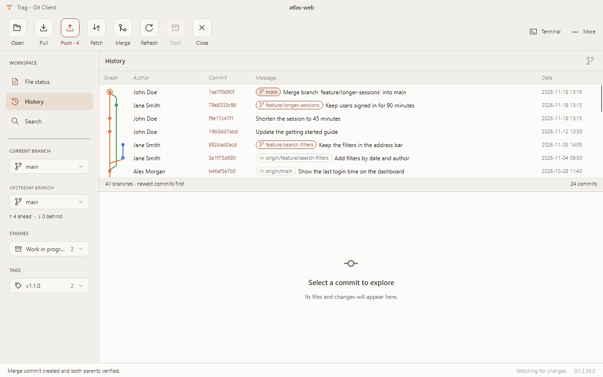
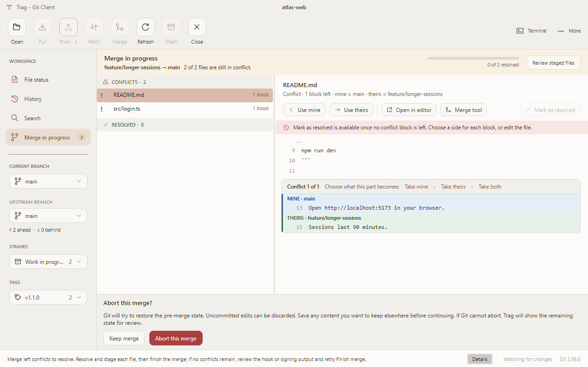

# 7. Resolving conflicts

A conflict happens when two branches change the same lines of a file in different ways, and Git cannot decide which
version is right. Trag shows each conflict side by side and lets you choose, block by block or for the whole file.

## Knowing in advance

Before a merge starts, the merge dialog checks whether it will conflict. When it will, it lists the files and the merge
button changes to **Merge and resolve conflicts…**.

You can still cancel at this point and nothing changes.

## Merge in progress

When a merge stops on conflicts, Trag opens **Merge in progress**. The sidebar shows it as an extra entry with the
number of files left, and the banner at the top shows which branch is coming in, how many files are resolved and a
progress bar.

On the left, **Conflicts** lists the files still in conflict, with the number of conflict blocks in each, and
**Resolved** lists the files you have finished. Click a file to see its conflicts on the right.

Each conflict block shows both versions:

- **Mine** is the version of the branch you are on, here `main`.
- **Theirs** is the version of the branch coming in, here `feature/longer-sessions`.

The lines around the block are shown too, so you can see where it sits in the file.

## Choosing a side

For each block, choose what it becomes:

- **Take mine** keeps your version.
- **Take theirs** keeps the incoming version.
- **Take both** keeps both versions, one after the other.

To decide for the whole file at once, use **Use mine** or **Use theirs** at the top.

When no conflict block is left, the file waits for you to check it. **Mark as resolved** then stages it and moves it to
the **Resolved** list.

If a conflict needs more than picking a side, you have two more options:

- **Open in editor** opens the file in the graphical editor configured for Git. Edit it, save it and come back.
- **Merge tool** opens the merge tool configured in Git (`merge.guitool` or `merge.tool`).

In both cases, review the result in Trag and click **Mark as resolved** when it is right. **Mark as unresolved**
brings the conflict back if you change your mind; Git recreates the conflicted file.

## Finishing the merge

When every file is resolved, the banner says so, the progress bar is full and **Finish merge** becomes available.
Each resolved file shows how it was resolved: **mine**, **theirs** or **edited**.

Check the merge commit message at the bottom, then click **Finish merge**. Trag makes the merge commit with both
parents, and the history shows the two branches joined.

**Review staged files** in the banner shows everything the merge commit will contain, in File status.

## Aborting

If you would rather not merge after all, click **Abort merge…**. Trag asks first, because uncommitted edits can be
lost.

**Abort this merge** asks Git to put everything back as it was before the merge started. **Keep merge** goes back to
resolving.

## Rebase, cherry-pick, revert and stash

The same tools appear whenever Git stops on a conflict:

- A **rebase** or **Edit commits** that stops shows the commits being replayed and which one stopped. After resolving,
  click **Continue rebase**, or **Skip this commit** to leave it out. **Abort rebase…** returns to where you started.
- A **cherry-pick** or **revert** that conflicts has **Finish cherry-pick** or **Finish revert**, and an abort button.
- A **stash** that cannot be applied cleanly shows a **Conflicts** entry in the sidebar, and the stash entry is kept.
