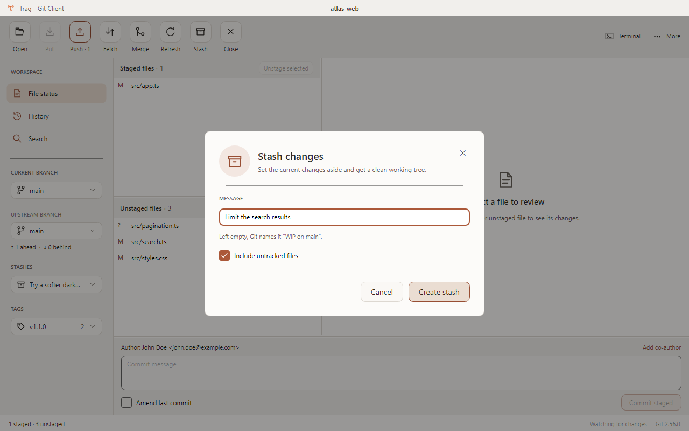
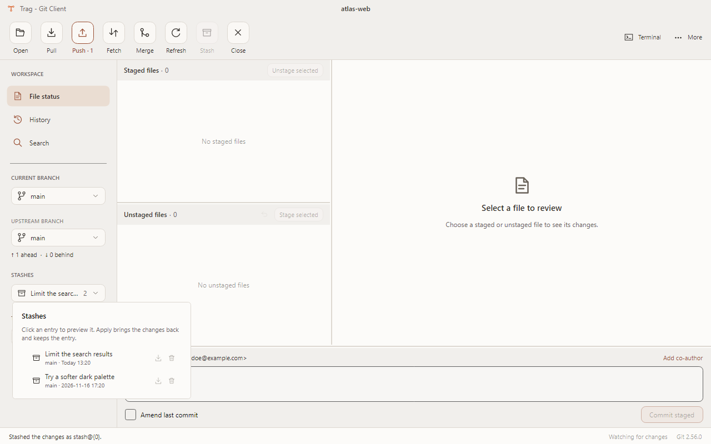
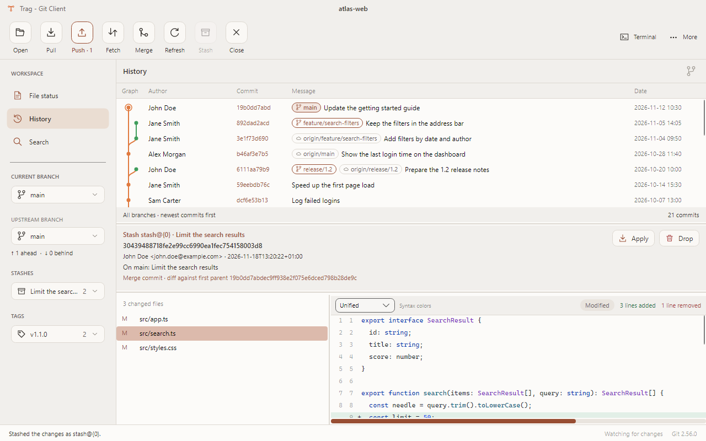
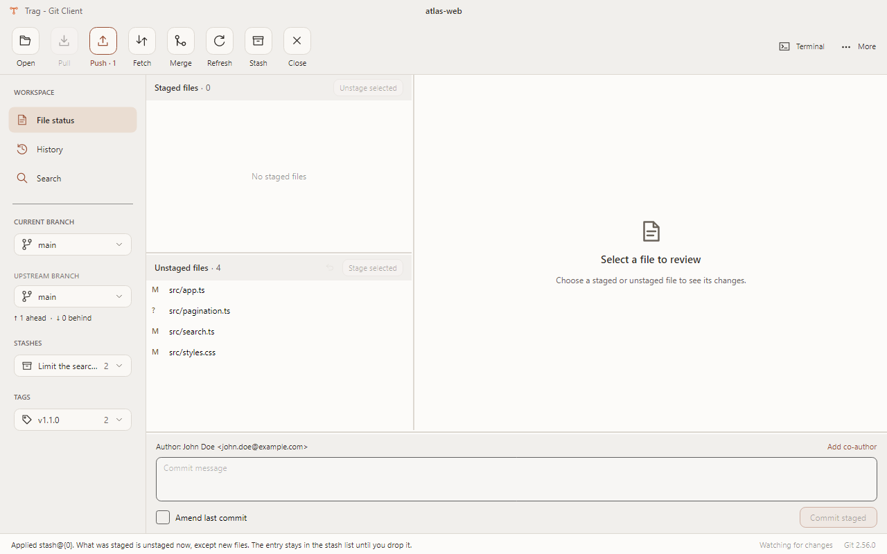
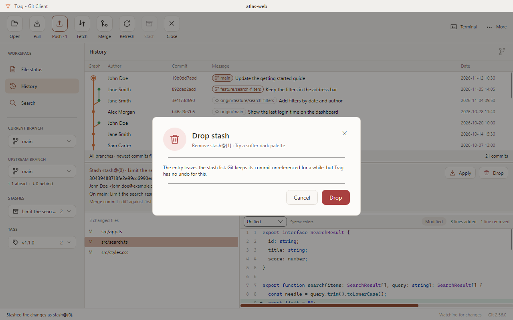

# 8. Stashes

A stash puts your uncommitted changes aside so you get a clean working tree, without making a commit. It is useful
when you need to switch branches, pull or look at something else in the middle of your work, and want to come back to
it later.

## Stashing your changes

Click **Stash** in the toolbar or press `Ctrl+Shift+K`.

- **Message** describes what you are setting aside, so you can find it again. If you leave it empty, Git names the
  stash after the branch, such as "WIP on main".
- **Include untracked files** also stashes new files that Git does not track yet. Without it, they stay in the working
  tree.

Click **Create stash**. Your working tree is clean again, and the new stash appears at the top of the stash list.

Trag also offers a stash when an action needs a clean working tree: the merge and rebase dialog, going to an older
commit, and discarding changes all have a way to stash first.

## The stash list

The **Stashes** button in the sidebar shows the newest stash and how many there are. Click it to see them all, each
with its message, the branch it was made on and when.

## Previewing a stash

Click a stash in the list to preview it. Trag shows it in the **History** section like a commit: its message, the
files it changed and, for the selected file, the diff.

**Apply** and **Drop** at the top right act on the stash you are looking at.

## Applying a stash

Click **Apply** in the preview, or the arrow next to a stash in the list. Trag brings the changes back into your working
tree and shows them in File status.

What was staged when you stashed comes back unstaged, except new files. The stash entry stays in the list until you
drop it, so you can apply the same stash again, for example on another branch.

If the stash cannot be applied cleanly, because the files changed in the meantime, Trag shows the conflicts the same way
as for a merge, and keeps the stash entry. See the chapter on resolving conflicts.

## Dropping a stash

When you no longer need a stash, click **Drop** in the preview or the bin next to it in the list. Trag asks first.

The entry leaves the stash list. Git keeps its commit for a while, but Trag has no undo for this, so drop a stash only
when you are sure.
