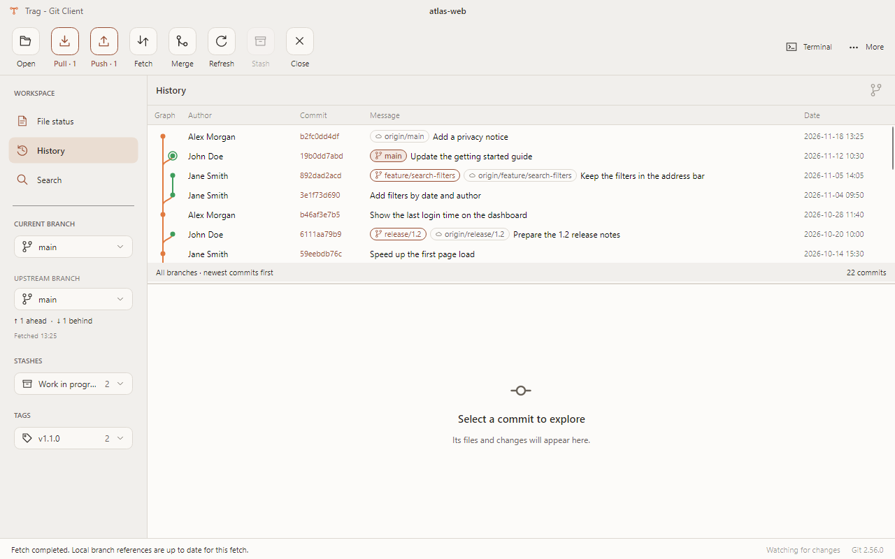
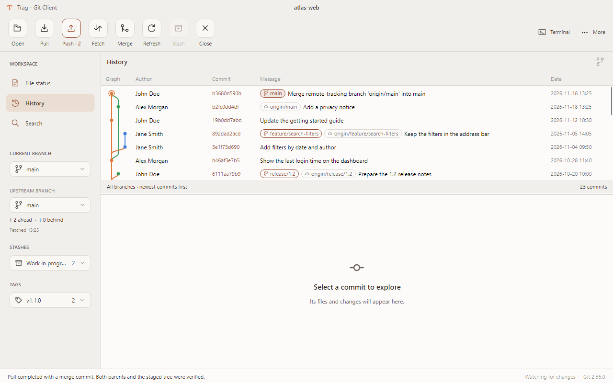
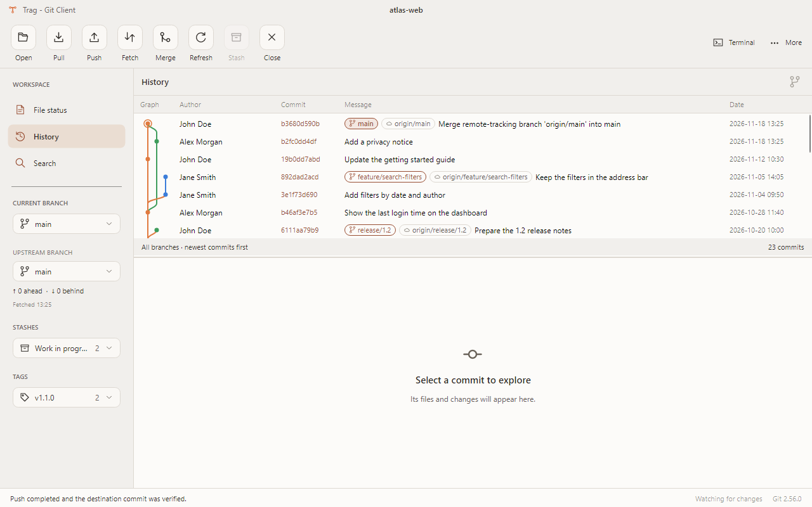
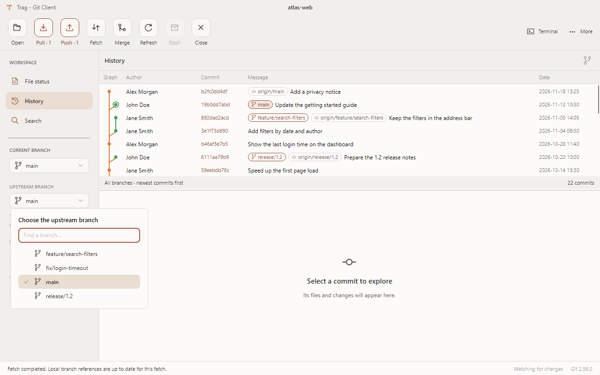
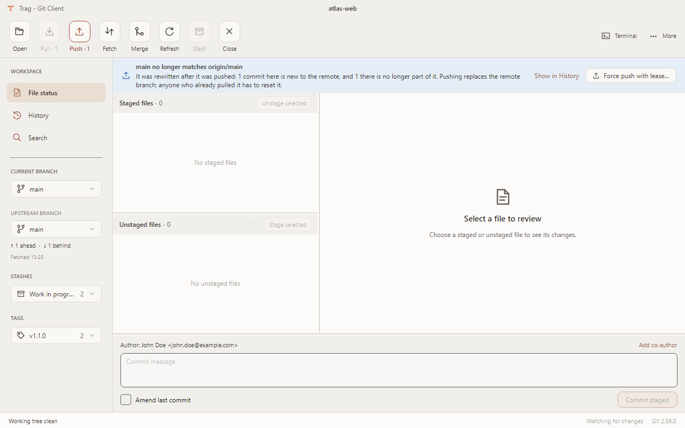
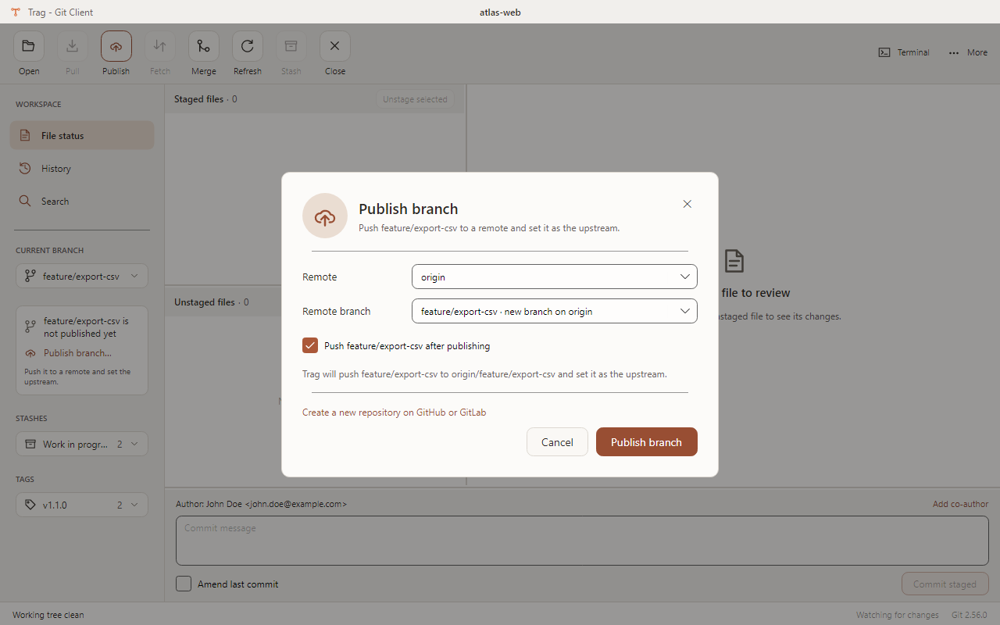
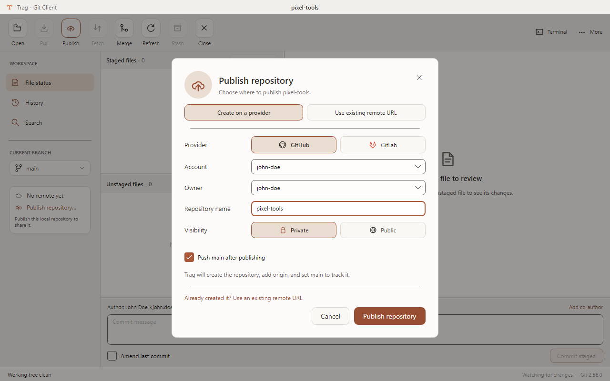
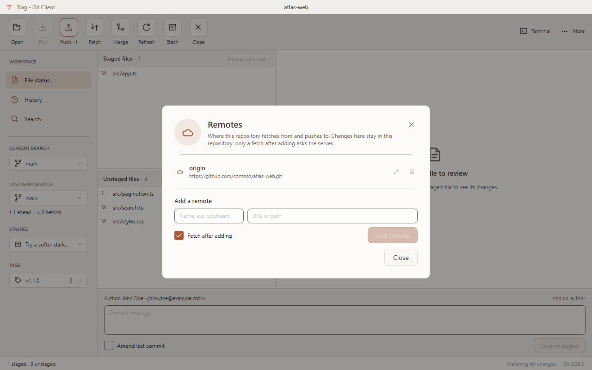

# 9. Syncing with remotes

A remote is a copy of the repository somewhere else, usually on GitHub or GitLab. This chapter shows how to bring in
what others pushed, send your own commits, publish new branches and repositories, and manage the remotes themselves.

## Where you stand

The sidebar always shows the **Upstream branch**, the remote branch your current branch syncs with, and how many commits
you are ahead (yours, not pushed yet) and behind (theirs, not pulled yet). After a fetch it also shows when it ran. The
**Pull** and **Push** buttons show the same numbers.

## Fetch

**Fetch** (`Ctrl+Shift+F`) downloads what is new on the remote without touching your branch or your files. Afterwards the
history shows the remote branches where they now are.

Here the fetch found a new commit on `origin/main`, so the sidebar shows **1 behind** and Pull shows **Pull · 1**.

Trag can also fetch on its own in the background. You turn that on in Settings, described in the next chapter.

## Pull

**Pull** (`Ctrl+Shift+L`) fetches and then brings the upstream branch into yours. When you have no commits of your own,
your branch simply moves forward. When both sides have new commits, Trag makes a merge commit, as here:

Pull needs a working tree without changes, so commit or stash your work first. If the pull runs into conflicts, they are
resolved like any merge. See the chapter on resolving conflicts.

## Push

**Push** (`Ctrl+Shift+P`) sends your commits to the upstream branch. When it is done, the sidebar shows **0 ahead** and
the status bar confirms that the remote now has your commits.

If you push to a GitHub or GitLab address where the repository does not exist under your account, Trag says so and
offers to create it.

## Choosing the upstream branch

Click the **Upstream branch** button to choose which remote branch your current branch syncs with.

When the repository has more than one remote, a second button above it chooses the remote.

## When a pushed branch was rewritten

If you amend, rebase or otherwise rewrite commits that were already pushed, your branch and the remote no longer match:
some commits are new here, and some that the remote has are no longer part of your branch. A normal push would be
refused, so Trag shows a banner in File status instead.

**Show in History** shows how the two differ. **Force push with lease…** replaces the remote branch with yours, but only
if nobody pushed to it in the meantime; Trag asks you to confirm first. Anyone who already pulled the old commits has to
reset their branch afterwards, so do this only on branches you own. **Keep remote** leaves the remote branch as it is.

## Publishing a branch

A branch you created locally has no upstream yet. The sidebar says it is not published, and **Publish** takes the place
of Push in the toolbar.

Choose the **Remote** and the **Remote branch** name, which is the same as the local name by default. With **Push after
publishing** ticked, Trag pushes the branch and sets it as the upstream in one step.

## Publishing a repository

A repository that has no remote at all can be published the same way. **Create on a provider** creates a new repository
on GitHub or GitLab with one of your accounts and pushes to it:

- **Provider** and **Account** choose where the repository goes.
- **Owner** is you or one of your organizations or groups.
- **Repository name** starts as the folder name.
- **Visibility** makes the repository private or public.

Trag creates the repository, adds it as `origin` and pushes the current branch. If you already created the repository
yourself, choose **Use existing remote URL** and paste its address instead.

## Remotes

**More → Remotes** lists the remotes of the repository with their addresses.

- The pencil changes a remote's name or address.
- The bin removes a remote, after you confirm.
- **Add a remote** takes a name and a URL or path. With **Fetch after adding** ticked, Trag fetches from it right away.

Changes here only affect this repository on your computer. Only the fetch after adding contacts the server.

## Signing in

For HTTPS addresses on GitHub and GitLab, Trag can sign in with the accounts you added in Settings, so you are not asked
for a password. When accounts match the remote's address, the sidebar shows an **Account** choice for the repository.
Otherwise, and for every other address, Git's own credential helpers and SSH keys work as they do on the command line.
