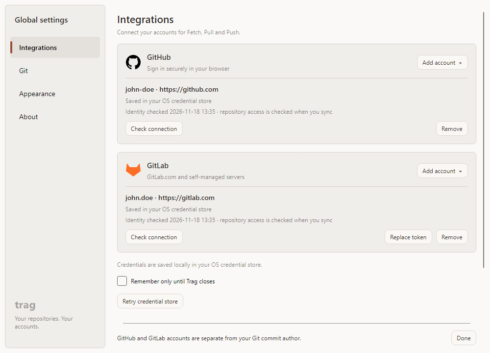
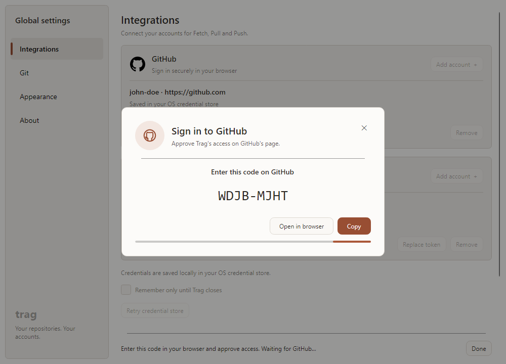
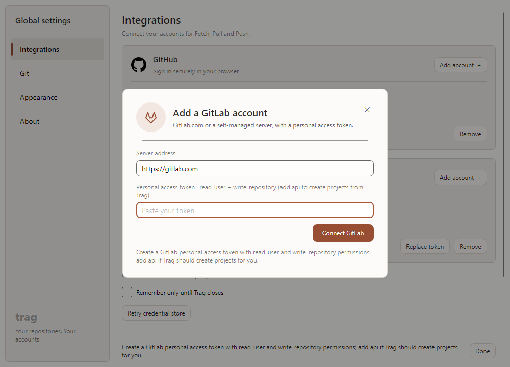
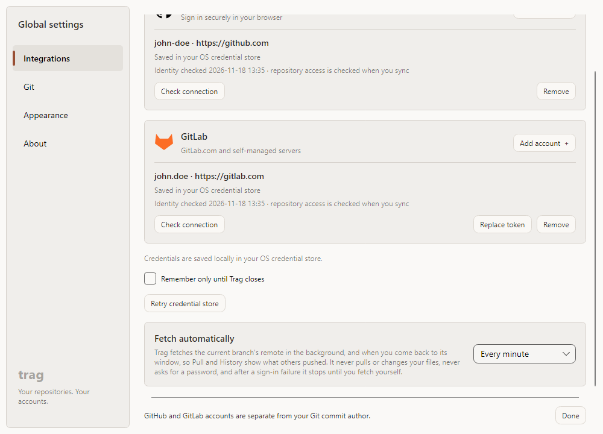
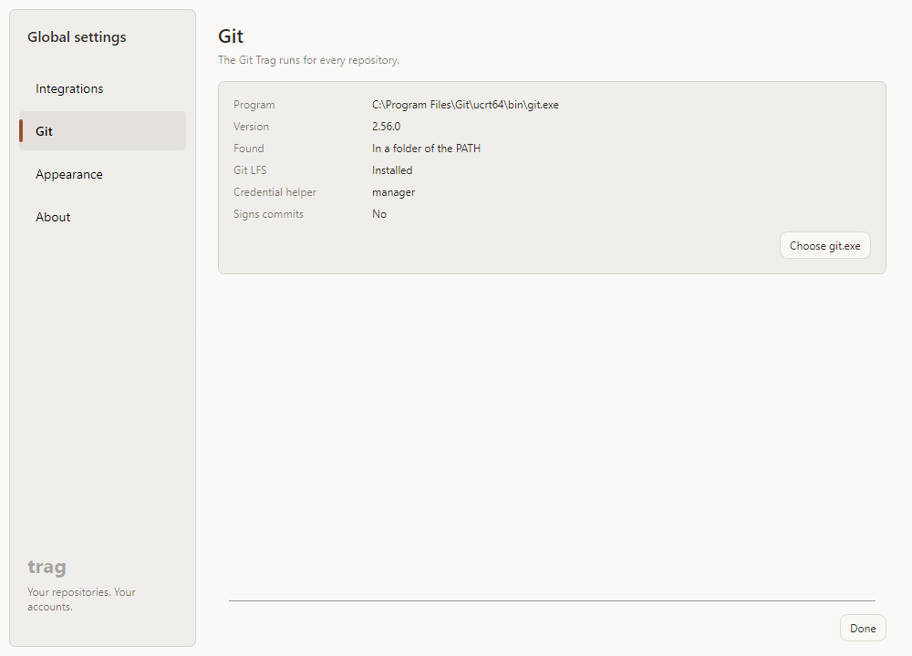
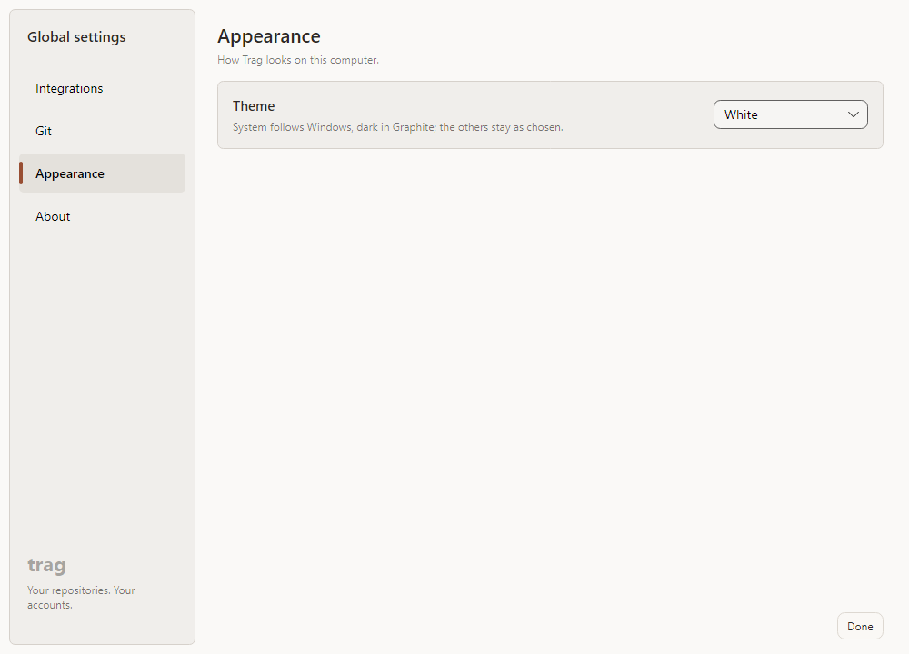
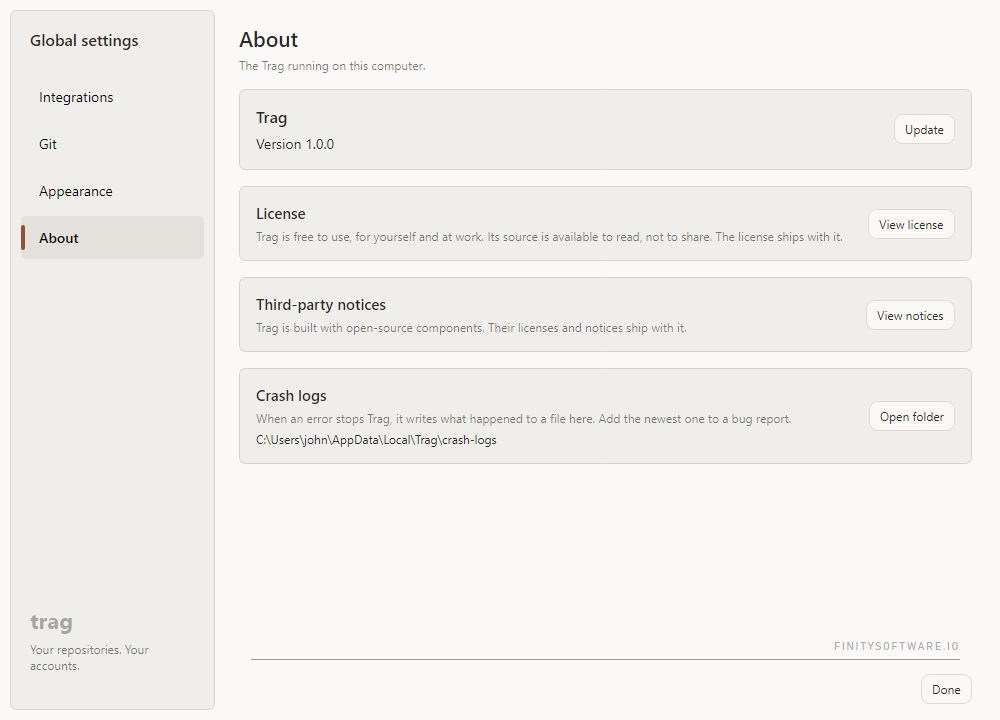

# 10. Accounts and settings

The settings window holds everything that applies to Trag as a whole: your GitHub and GitLab accounts, the Git
program Trag uses, the theme and information about the version you are running.

Open it with `Ctrl+,`, with **More → Settings**, or with **Add account** in the sidebar of the Repositories page. The
pages are listed on the left; **Done** closes the window.

## Integrations

**Integrations** lists your GitHub and GitLab accounts. Trag uses them to list your repositories, clone, publish, and
sign in when you fetch, pull and push over HTTPS.

Each account shows its name, the server, where its credentials are kept and when its identity was last checked.

- **Check connection** asks the provider again whether the account works.
- **Remove** takes the account out of Trag, after you confirm.
- **Replace token**, for GitLab, swaps the access token for a new one.

Your accounts are separate from the author of your commits. The name and address on a commit still come from your Git
configuration.

### Adding a GitHub account

Click **Add account** on the GitHub card. Trag shows a code and opens GitHub's sign-in page in your browser.

Enter the code on GitHub and approve the access. **Copy** puts the code on the clipboard, and **Open in browser** opens the
page again if you closed it. As soon as you approve, the account appears in the list. Trag never sees your GitHub
password.

GitHub lists every permission Trag asks for on its approval page. Trag asks for all of them in one go, so the same
sign-in covers repositories, workflows, organizations and the rest, and you do not have to sign in again later.

### Adding a GitLab account

Click **Add account** on the GitLab card.

- **Server address** is `https://gitlab.com`, or the address of your company's own GitLab server.
- **Personal access token** is a token you create in GitLab under your user settings. Give it the `read_user` and
  `write_repository` scopes, and `api` too if you want Trag to create projects for you.

Click **Connect GitLab**. Trag checks the token and adds the account.

### Where credentials are kept

Account tokens are saved in your system's credential store: the Windows Credential Manager, or the keyring on Linux.
They are never written to a plain file.

If the credential store is locked or unavailable, Trag says so. **Retry credential store** tries again after you
unlock it. **Remember only until Trag closes** lets you add an account anyway; you then sign in again the next time you
start Trag.

### Fetching automatically

At the bottom of the Integrations page, **Fetch automatically** sets how often Trag fetches in the background: off, every
minute, every 5 minutes or every 15 minutes.

Trag fetches the current branch's remote at that interval, and when you come back to its window, so Pull and History
show what others pushed. It never pulls or changes your files and never asks for a password. If signing in fails, it
stops until you fetch yourself.

## Git

The **Git** page shows the Git program Trag runs for every repository: where it is, its version, how Trag found it,
whether Git LFS is installed, which credential helper Git uses and whether it signs commits.

Trag uses the Git it finds on your system. **Choose git.exe** lets you pick another one, for example a portable Git.
**Use the Git Trag finds** goes back to the automatic choice. Trag needs Git 2.43 or newer.

## Appearance

**Appearance** sets the theme.

**White** is the light theme used in this manual. **Espresso**, **Graphite**, **Obsidian** and **Vantablack** are dark
themes of different depth. **System theme** follows Windows: White when Windows is light, Graphite when it is dark.

## About

**About** shows the version of Trag you are running.

- **Update** checks whether a newer version is available. When there is one, a **Download** button opens its download
  page in your browser.
- **View license** opens Trag's license, and **View notices** the licenses of the open-source components Trag uses.
- **Crash logs** shows the folder where Trag writes a report when an error stops it. **Open folder** opens it, so you can
  attach the newest file to a bug report.
